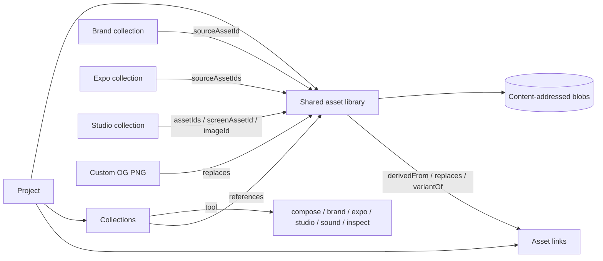

# Global Projects — actionable plan

**Status:** proposal, not implemented. Date: 2026-11-27.
**Goal:** one user-created **Project** holds every tool's saved state and shared assets. A brand mark chosen once can be reused by Expo Assets, Screenshot Studio, SVG Compose and the OG editor. Projects switch instantly and assets can be copied or moved between them.

**Scoped out:** there is no "Workspace" layer now. Workspaces are a later concept for multiplayer (groups of projects). Every record still carries `projectId`, so adding `workspaceId` later is additive.

---

## 0. TL;DR recommendation

1. **Projects are the only global container.** No nested container inside any tool — including Screenshot Studio.
2. **Every tool gets the same "collections" ability.** A project holds a list of collections; each collection is one tool document. Studio boards, Compose docs, Brand kits, Expo sets, Sound boards and Inspect snapshots are all just collections. One default collection per tool is created with a new project; users can add more.
3. **Shared asset library per project** with durable asset IDs and content-addressed blobs. Replace ephemeral `AssetInput.handle` and Studio's inline `data:` assets with references to this library.
4. **`/` becomes a project home** with a project switcher in the shell, and tools route under `/projects/:projectId/...`.
5. Implement in five phases with native and browser adapters behind one client contract.

**Hard rule:** either every tool supports multiple collections or none does. Recommendation: **all of them do** — Studio already relies on multiple boards and scene strips, and Compose needs multiple docs. Removing that ability would be a regression; special-casing one tool is what makes Studio feel different.

---

## 1. What exists today (ground truth)

| Surface | Durable state | Where | Notes |
| --- | --- | --- | --- |
| Screenshot Studio | `StudioSnapshot = { board: BoardRow, nodes, events, assets }`; `SceneCollection[]` inside `board.collections`; `AssetRow { id, name, mime, data }` with `data` a data URL | Standalone: SQLite `projects/<id>.sqlite`; desktop: IndexedDB `assets-toolbox-screenshot-studio`, store `projects` | Studio owns its own "project" list today. That list must go away as a separate concept — it becomes a set of Studio **collections** inside a global project. |
| SVG Compose | `WorkspaceDocument { id, name, svg, viewport, updatedAt }` | Wails: `…/assets-toolbox/svg-compose/workspace.json`; Node: `.svg-compose/workspace.sqlite` | One `draft` row only. `WorkspaceID()` hashes the storage path, not a user project. |
| Brand Assets | All form state, selected icon, OG design, job result in React state | Nothing durable | `assetInputs` handles are in-memory; generated files live in temp `assetgen-*` dirs until discard. |
| Expo Assets | Same shape as Brand | Nothing durable | Same Go manager, handles and temp roots. |
| Cabra Sound | `cabra-sound`, `cabra-volume`, `cabra-sound:favorites` | `localStorage` | Global, not project-scoped. |
| Social Inspect | `?url=` in router; report in memory | Nothing durable | Proxied assets have a 1 h HTTP cache only. |
| Shell | `assets-toolbox-theme`, `assets-toolbox-sidebar` | `localStorage` | Boots to a static `LibraryPage`; no launch screen. |
| Native dialogs | `{"open":"…","save":"…"}` | `…/assets-toolbox/dialogs.json` | Shared by Brand + Expo. No folder-picker binding. |

Constraints found in code:

- `SelectAssetImage` returns a random 12-byte handle mapped to a path in `App.assetInputs` (memory only). Handles die with the process; they are request-scoped temp paths, not durable identity.
- Asset jobs are temp dirs (`os.MkdirTemp`), removed on discard/shutdown. There is no "commit outputs to the project" step.
- Studio assets are base64 data URLs referenced by `BoardFill.imageId`, `SliceBand.imageId`, `DeviceNode.screenAssetId` and `ShapeNode.imageId`.
- The close-flush protocol is hardcoded to `DesktopModule = "workspace" | "studio"`.
- The standalone/desktop split already uses an adapter (`src/server/fns` aliased to `src/desktop/browser-fns.ts` with IndexedDB). Reuse it.

---

## 2. Terminology

| Term | Meaning |
| --- | --- |
| **Project** | Global, user-created container. Holds a manifest, a shared asset library and collections. Examples: "Acme Mobile", "Client X". |
| **Tool** | One of `compose`, `brand`, `expo`, `studio`, `sound`, `inspect`. |
| **Collection** | One saved document of one tool inside a project. Every tool supports many collections. Studio boards and Compose docs are collections; Brand/Expo forms are collections too. |
| **Asset** | Durable, content-addressed file record in the project library (source upload, generated output or export). |
| **Reference** | Pointer from a collection field to an asset ID, e.g. `expo.source.icon → a_…`. |
| **Link** | Typed relationship between two assets: `derivedFrom`, `replaces`, `variantOf`. |
| **Workspace** *(later)* | Optional grouping of projects for multiplayer. Not implemented now. |

Studio's internal **scene strips** (`SceneCollection`) remain a feature *inside* a Studio collection's data. They are not a second global container and are not the same thing as project collections.

---

## 3. Making Studio behave like the others

This is a first-class workstream, not a footnote:

- `ProjectHome` stops owning projects. Its embedded header becomes a **collection list for the active global project**, using the shared `ToolHeader` pattern: identity + "New collection", "Rename", "Clone", "Delete" actions.
- `Studio` board route becomes `/projects/:projectId/studio/:collectionId`. There is no Studio-local `projectId` and no Studio-local storage.
- `StudioSnapshot` stays the collection's `data` shape; `assets` become `assetIds` referencing the shared library.
- `board.collections` (scene strips) stay exactly as they are inside the snapshot — a Studio-specific document feature.
- Focus (`assets-toolbox:screenshot-studio:focused` / `open.json`) is replaced by global "last opened collection" state stored with the project.
- `browser-fns.ts` / server `/api/projects` adapters are replaced by the generic project client; the Studio-specific SQLite-per-project and IndexedDB database are migration sources only.
- Result: creating, renaming, cloning, deleting and switching collections works identically in Studio, Compose, Brand, Expo, Sound and Inspect.

---

## 4. Relationship map

### 4.1 Tool-by-tool

| Tool | Produces | Consumes | References in the new model |
| --- | --- | --- | --- |
| Brand | favicons, apple icon, webmanifest, `og.png`, custom OG PNG | one chosen mark, OG text, colors | `sourceAssetId`; outputs stored as assets with `origin.tool = "brand"` |
| Expo | app/adaptive/splash/favicon/notification icons, config fragment | up to 3 logos (`icon`, `darkIcon`, `tintedIcon`) | `sourceAssetIds.*` — **can point at the brand mark asset** |
| Studio | scene-slice PNGs (ZIP), board snapshots | imported images | `assetIds`; node `screenAssetId`/`imageId` point at shared assets |
| Compose | SVG/PNG exports | imported/pasted SVG or PNG | collection holds `svg` + `viewport`; imports stored as assets |
| OG editor | custom `og.png` | selected mark data URL + layers | exported PNG is an asset linked `replaces` → generated `og.png` |
| Sound | WAV/ZIP downloads | favorites, mute, volume | `SoundCollectionData`; global keys migrate in |
| Inspect | reports, copied metadata | URL | optional `InspectCollectionData` with captured OG image as asset |

### 4.2 Entity diagram



### 4.3 Example flow: brand mark → Expo → Studio

1. Import `logo.svg` into project **Acme Mobile** → asset `a_logo`, `kind: "source"`.
2. Brand collection sets `sourceAssetId = a_logo`; generated icons become assets with `origin.derivedFrom = a_logo`.
3. Expo collection offers "Use project brand mark" → `sourceAssetIds.icon = a_logo` (a reference, no duplicate blob); its outputs link `derivedFrom = a_logo`.
4. Studio collection references `a_logo` and can use it as a device screen or shape fill.
5. Moving `a_logo` to another project offers **copy** (new ID, blob copy, refs rewired), **move** (only if nothing in this project still references it) or **link** (cross-project reference with a badge and warning).

---

## 5. Target data model

### 5.1 Core types (`apps/desktop/frontend/src/lib/projects/types.ts`)

```ts
export type ToolId = "compose" | "brand" | "expo" | "studio" | "sound" | "inspect";
export type ProjectId = `p_${string}`;
export type CollectionId = `c_${string}`;
export type AssetId = `a_${string}`;

export interface ProjectSummary {
  id: ProjectId;
  name: string;
  updatedAt: string;
  lastOpenedAt?: string;
  path?: string; // native only
  counts: { assets: number; collections: number };
}

export interface ProjectManifest {
  id: ProjectId;
  name: string;
  createdAt: string;
  updatedAt: string;
  schemaVersion: number;
  settings: { defaultOutDir: string; theme?: "light" | "dark" };
}

export interface CollectionRecord<T = unknown> {
  id: CollectionId;
  projectId: ProjectId;
  tool: ToolId;
  name: string;
  data: T;
  createdAt: string;
  updatedAt: string;
}

export type AssetKind = "source" | "generated" | "export" | "download";

export interface AssetRecord {
  id: AssetId;
  projectId: ProjectId;
  name: string;
  mime: string;
  bytes: number;
  width?: number;
  height?: number;
  hash: string; // sha256 of bytes
  kind: AssetKind;
  origin?: { tool: ToolId; collectionId?: CollectionId; derivedFrom?: AssetId };
  tags: string[];
  refs: CollectionRef[];
  createdAt: string;
}

export interface CollectionRef {
  tool: ToolId;
  collectionId: CollectionId;
  field: string; // "source.icon", "nodes.n1.screenAssetId", …
}

export interface AssetLink {
  from: AssetId;
  to: AssetId;
  type: "derivedFrom" | "replaces" | "variantOf";
}
```

Collection data shapes:

```ts
interface StudioCollectionData {
  board: BoardRow;          // includes SceneCollection[] (scene strips)
  nodes: StudioNode[];
  events: EventRow[];
  assetIds: AssetId[];
}

interface ComposeCollectionData { name: string; svg: string; viewport: StageViewport }

interface BrandCollectionData {
  sourceAssetId: AssetId | null;
  form: BrandForm;          // plate, copySvg, og*, manifest*, outDir
  ogDesign?: OgDesignResult;
  outputAssetIds: AssetId[];
}

interface ExpoCollectionData {
  sourceAssetIds: { icon?: AssetId; darkIcon?: AssetId; tintedIcon?: AssetId };
  form: ExpoForm;           // colors, sizes, flags, outDir
  outputAssetIds: AssetId[];
  configAssetId?: AssetId;
}

interface SoundCollectionData { favorites: string[]; volume: number; enabled: boolean }
interface InspectCollectionData { url: string; report?: InspectReport }
```

### 5.2 On-disk layout (native)

```text
<UserConfigDir>/assets-toolbox/
  projects.json                      # registry: ProjectSummary[]
  dialogs.json                       # unchanged
  projects/
    p_<id>/
      project.json                   # ProjectManifest
      assets/
        index.json                   # AssetRecord[] + AssetLink[]
        blobs/<aa>/<sha256>          # immutable, deduped by hash
      collections/
        compose/<collectionId>.json
        brand/<collectionId>.json
        expo/<collectionId>.json
        studio/<collectionId>.json
        sound/<collectionId>.json
        inspect/<collectionId>.json
      exports/                       # optional saved ZIP/PNG copies
```

One folder per project makes a project portable (zip the folder), dedupes blobs by hash, and mirrors the atomic-write pattern from `apps/desktop/workspace.go`.

### 5.3 Browser/dev parity

One `ProjectClient` interface, two implementations:

- **Native** — HTTP `/api/projects*` for metadata/JSON; Wails bindings only for native file operations: `ImportFileAsAsset(path)`, `ExportAsset(path)`, `ExportProjectBundle`.
- **Browser** — IndexedDB `assets-toolbox-projects`, stores `projects`, `assets`, `blobs` (Blob values, not base64 strings), `collections`; serialize per collection with `navigator.locks`, as Studio already does.

Keep `/api/workspace` as a compatibility alias to the default project's first Compose collection until phase 3. The browser image-preview fallback (`selectWebImage()`) becomes the browser asset-import path. Generation stays native-only.

---

## 6. Launch screen, switching and collections UI

### 6.1 Launch screen (`/` replaces `LibraryPage`)

```text
┌──────────────────────────────────────────────────────────────────────┐
│ Assets Toolbox                [Project: Acme Mobile ▾]  [+ New]      │
├──────────────────────┬───────────────────────────────────────────────┤
│ PROJECTS             │ Acme Mobile                                   │
│  • Acme Mobile  ●    │ Updated 2h ago · 42 assets · 9 collections     │
│  • Side Project      │                                               │
│  • Client X          │ Tools:  [Studio] [Brand] [Expo] [Compose]     │
│  [+ New project]     │         [Sound] [Inspect]                     │
│                      │                                               │
│                      │ Shared assets (recent)                        │
│                      │ [logo] [favicon] [hero] [og]  → Library       │
│                      │                                               │
│                      │ Recent collections                            │
│                      │ • Launch screens (Studio)      12 min ago     │
│                      │ • App icons (Expo)             yesterday      │
└──────────────────────┴───────────────────────────────────────────────┘
```

### 6.2 Uniform collection bar

Every tool uses the same collection controls inside the shared `ToolHeader`:

```
[tool icon] Tool name   Collection: [Launch screens ▾]   [+ New] [Rename] [Clone] [Delete]   …tool actions
```

The dropdown lists all collections of that tool in the project and switches in place. Same component, same keyboard behavior, same shortcuts everywhere — including Studio.

### 6.3 Routing and switching

- `/` project home; `/projects/:projectId` project dashboard; `/projects/:projectId/:tool/:collectionId?` tool/document.
- Keep old routes as redirects to the active project so bookmarks don't break.
- Switching projects:
  1. Flush the active tool (extend `DesktopFlushProvider` with a `projects` module).
  2. Update `activeProjectId` and `lastOpenedAt` in `projects.json`.
  3. Navigate to the same tool under the new project ID and force a remount (key on `projectId`) so no state leaks.
  4. Toast: "Switched to Client X".
- The project switcher stays visible in the shell header and collapsed sidebar on every route.

### 6.4 Move / copy between projects

From the shared asset library: select assets → **Move to project…**

- **Copy** (default): new asset records + blob copies in the target, references rewired in copied collections.
- **Move**: only if nothing in the source project still references the asset; otherwise the UI explains what uses it and offers Copy or Link.
- **Link**: cross-project reference, shown with a badge; deleting the source warns about broken links.
- Offer "include derived outputs" (e.g. moving a brand mark also moves its favicons and Expo outputs).

---

## 7. API surface

### 7.1 HTTP

```text
GET    /api/projects
POST   /api/projects                  { name }
GET    /api/projects/:id
PATCH  /api/projects/:id              { name?, settings? }
DELETE /api/projects/:id              { transferTo?: id }

GET    /api/projects/:id/collections/:tool
POST   /api/projects/:id/collections/:tool      { name, data? }
GET    /api/projects/:id/collections/:tool/:collectionId
PUT    /api/projects/:id/collections/:tool/:collectionId   { name?, data }
DELETE /api/projects/:id/collections/:tool/:collectionId

GET    /api/projects/:id/assets
POST   /api/projects/:id/assets       { name, mime, base64 } | { importPath } (native)
GET    /api/projects/:id/assets/:assetId/blob
PATCH  /api/projects/:id/assets/:assetId        { name?, tags? }
DELETE /api/projects/:id/assets/:assetId
POST   /api/projects/:id/assets/move  { assetIds, targetProjectId, mode: copy|move|link, includeDerived }
```

### 7.2 Wails bindings (native-only)

`ImportFileAsAsset`, `ExportAsset`, `ExportProjectBundle`. Add `PickProjectFolder` only if "open project folder" is required in phase 1.

### 7.3 Events / flush

- Add `projects` to `DesktopModule` in both Go and TS (`"workspace" | "studio" | "projects"`).
- Subscribe to `projects:active/inactive/flushed` in `App.startup`; include `projects` in `beforeClose`'s flush cycle.
- Register a `projects` flush that saves all dirty project/collection state.

---

## 8. Migration strategy

| Existing data | Migration |
| --- | --- |
| Studio embedded IndexedDB `assets-toolbox-screenshot-studio` | Import every `StoredProject` as a Studio collection in the default project; `StudioSnapshot` maps almost 1:1. Keep the old store read-only for two releases. |
| Studio standalone `projects/*.sqlite` | Convert each into a Studio collection JSON; leave the original `.sqlite` files untouched. |
| SVG Compose `workspace.json` / `draft` | Import as the first Compose collection in the default project. `/api/workspace` aliases it until phase 3. |
| Brand/Expo in-memory state and live jobs | Commit any live job's outputs as project assets before discarding; otherwise nothing to migrate. |
| `cabra-sound*` keys | Migrate into the default Sound collection. Keep global reads as fallback for one release. |
| Social Inspect `?url=` | Store as an Inspect collection when the user saves it; otherwise remains ephemeral. |
| `dialogs.json`, theme, sidebar | Unchanged global settings. |

Migration is idempotent and writes `schemaVersion` into the project registry.

---

## 9. Phased implementation

### Phase 1 — Core project store, launch screen, uniform collections shell

- [ ] `lib/projects/types.ts`, `client.ts`, `native-client.ts`, `browser-client.ts`.
- [ ] Go `apps/desktop/projects.go`: registry, manifest, collections, atomic writes, HTTP handlers; wire into `main.go`.
- [ ] Add `projects` to the flush protocol (`app.go`, `lib/desktop.ts`, `lib/flush.tsx`).
- [ ] Generic `CollectionBar` component using the shared `ToolHeader`; use it in every tool, starting with Studio.
- [ ] `ProjectHome` launch screen + project switcher in `AppShell`; `/projects/:projectId/*` routes with legacy redirects.
- [ ] Tests: registry CRUD + restart persistence; browser IndexedDB CRUD; switcher flush ordering.
- **Done when:** projects can be created/renamed/deleted/switched and collection switching works identically in all tools.

### Phase 2 — Shared asset library + Brand/Expo

- [ ] Asset records, blob store by SHA-256, blob GET, `ImportFileAsAsset`.
- [ ] Replace `AssetInput.handle` refs with `AssetId`; keep handles only inside generation requests (resolve asset → staged temp file).
- [ ] "Use project brand mark" in Expo; autosave Brand/Expo forms as collections.
- [ ] Commit generated outputs as assets before `DiscardAssetJob`; flat asset list in both tools.
- [ ] Tests: dedupe by hash, output commit, cross-tool reference resolves, generation still native-only.
- **Done when:** one mark drives Brand and Expo, and both reopen with form + outputs intact.

### Phase 3 — Compose + Studio migration

- [ ] Compose becomes multiple collections; `/api/workspace` compatibility alias to the first collection.
- [ ] Studio uses the generic collections client; `StudioSnapshot` becomes collection `data`; assets become `assetIds`.
- [ ] Remove Studio-owned project DB/IndexedDB from the read path; keep as migration source only.
- [ ] OG exported PNG becomes an asset with `replaces → generated og.png`.
- [ ] Inspect optional saved reports.
- [ ] Tests: Studio round-trip, old snapshot migration, compose draft migration.
- **Done when:** no tool owns a separate project store; everything lives in the global project.

### Phase 4 — Move/copy between projects + bundles

- [ ] `POST /assets/move`, reference audit, derived-assets inclusion.
- [ ] `ExportProjectBundle` (ZIP of manifest + collections + assets) and import, with ID/hash collision handling.
- [ ] Tests: copy/move/link with references; bundle round-trip.
- **Done when:** assets and outputs can move between projects without dangling references.

### Phase 5 — Polish

- [ ] Uniform collection keyboard shortcuts and empty states.
- [ ] Project templates ("Blank app", "Marketing site") prefill collection defaults.
- [ ] Docs: `README.md`, Studio `docs/usage.md`, and mark this plan implemented.
- [ ] Remove compatibility aliases.

---

## 10. Risks and open questions

| Risk / question | Recommendation |
| --- | --- |
| Studio's `AssetRow.data` uses base64 data URLs; large images can exceed IndexedDB quota. | Store Blobs in the browser adapter, blobs on disk natively; keep `data:` only as a migration fallback. |
| Generated job roots are deleted on discard. | Add explicit "commit to project" in phase 2; never treat a job ID as durable. |
| Cross-project references break if a source project is deleted. | Default to copy; link is opt-in with a badge; deletion warns and lists affected projects. |
| Uniform collections means more UI work in tools that currently have one form. | Ship one default collection per tool and a shared `CollectionBar` component — the cost is mostly one component, not six. |
| Studio's "collections" (scene strips) vs project collections — confusing names. | Always say "scene strips" for Studio internals; "collections" only for the global per-tool documents. |
| SVG Compose standalone `/api/workspace`. | Alias to the default project's first Compose collection; remove in phase 3. |
| 8 MB input / 16 MiB artifact limits. | Keep; enforce the same limits at asset import. |
| Default project name. | `"My Project"` created on first run; all existing data migrates into it. |
| Future Workspaces (multiplayer). | Additive `workspaceId` on `ProjectSummary`/`ProjectManifest` later; no schema churn for collections or assets. |

**Decisions to confirm before phase 1:**
1. Confirm **all tools get multiple collections** with one default each (recommended), rather than freezing Studio's current model.
2. Confirm Sound favorites migrate into a Sound collection (recommended) rather than staying global.
3. Confirm copy/move only in phase 4, with cross-project link added behind a warning (recommended).

---

## 11. Reuse inventory

- `assetgen.Manager` + sidecar protocol — keep for generation; add commit-to-project.
- `assetgen` path validation (`resolveInRoot`, `normalizeOutDirChecked`) — reuse for blob access.
- `workspaceStore.save()` atomic 0600 write pattern — reuse for project files.
- `dialogs.json` — unchanged.
- Studio's `StudioSnapshot`, `BoardRow`, `SceneCollection`, `ProjectSummary` shapes — basis for Studio collection data.
- Studio's `navigator.locks` serialization — reuse for browser collections.
- `DesktopFlushProvider` + Go close handshake — extend with `projects`.
- `ToolHeader` compound component — host the shared collection controls.
- `selectWebImage()` browser fallback — browser asset-import path.
