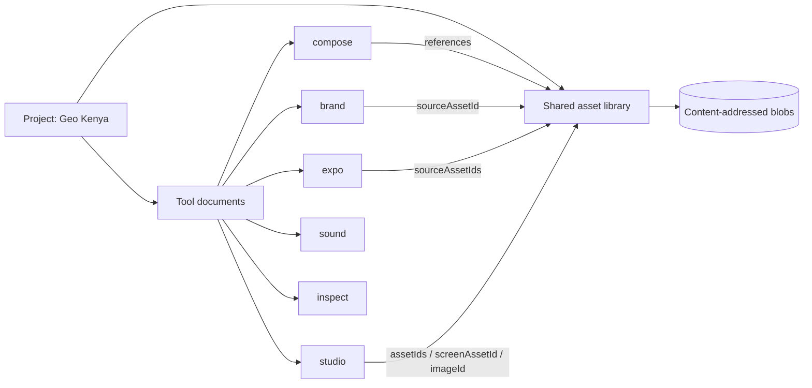

# Global Projects — actionable plan

**Status:** Phase 1 implemented 2026-11-27 (core store, launch screen, project switching, Brand/Expo/Sound/Inspect documents). Phase 2 in progress: project asset library with upload, blob previews, copy/move is done; tool generation wiring remains.
**Goal:** create a project (e.g. "Geo Kenya") and every related asset and tool document for it lives in that project's own folder. Brand, Expo, Studio, Compose, Sound and Inspect all read and write the same project. A brand mark chosen once can be referenced by Expo and Studio; assets can be copied or moved between projects.

**Scoped out / future TODO:** multiple collections per tool, cross-project links, and Workspaces (multiplayer). See §10.

---

## 0. TL;DR recommendation

1. **A Project is the only container.** Create one per client/app (e.g. "Geo Kenya"). Inside it, each tool owns one subfolder/document and all assets live in one shared library.
2. **One document per tool per project.** No collection switcher yet. Studio's board becomes a normal project document, not a nested project.
3. **Shared asset library per project** with durable asset IDs and content-addressed blobs. Replace ephemeral `AssetInput.handle` and Studio's inline `data:` assets with references to this library.
4. **Sound favorites are project-scoped** and stored in the project's sound document.
5. **`/` becomes a project home** with a project switcher in the shell, and tools route under `/projects/:projectId/:tool`.
6. Build native and browser adapters behind one client contract, in five phases.

---

## 1. What exists today (ground truth)

| Surface | Durable state | Where | Notes |
| --- | --- | --- | --- |
| Screenshot Studio | `StudioSnapshot = { board: BoardRow, nodes, events, assets }`; scene strips in `board.collections`; `AssetRow.data` is a data URL | Standalone: SQLite `projects/<id>.sqlite`; desktop: IndexedDB `assets-toolbox-screenshot-studio` | Studio owns its own project list today. It becomes a single document inside a global project. |
| SVG Compose | `WorkspaceDocument { id, name, svg, viewport, updatedAt }` | Wails: `…/assets-toolbox/svg-compose/workspace.json`; Node: `.svg-compose/workspace.sqlite` | One `draft` row only. `WorkspaceID()` hashes the storage path, not a user project. |
| Brand Assets | Form state, selected icon, OG design, job result in React state | Nothing durable | `assetInputs` handles are in-memory; generated files live in temp `assetgen-*` dirs until discard. |
| Expo Assets | Same shape as Brand | Nothing durable | Same Go manager, handles and temp roots. |
| Cabra Sound | `cabra-sound`, `cabra-volume`, `cabra-sound:favorites` | `localStorage` | Global today; moves into the project sound document. |
| Social Inspect | `?url=` in router; report in memory | Nothing durable | Proxied assets have a 1 h HTTP cache only. |
| Shell | `assets-toolbox-theme`, `assets-toolbox-sidebar` | `localStorage` | Boots to a static `LibraryPage`; no launch screen. |
| Native dialogs | `{"open":"…","save":"…"}` | `…/assets-toolbox/dialogs.json` | Shared by Brand + Expo. No folder-picker binding. |

Constraints found in code:

- `SelectAssetImage` returns a random 12-byte handle mapped to a path in `App.assetInputs` (memory only). Handles die with the process — request-scoped temp paths, not durable identity.
- Asset jobs are temp dirs (`os.MkdirTemp`), removed on discard/shutdown. There is no "commit outputs to the project" step.
- Studio assets are base64 data URLs referenced by `BoardFill.imageId`, `SliceBand.imageId`, `DeviceNode.screenAssetId` and `ShapeNode.imageId`.
- The close-flush protocol is hardcoded to `DesktopModule = "workspace" | "studio"`.
- The standalone/desktop split already uses an adapter (`src/server/fns` aliased to `src/desktop/browser-fns.ts` with IndexedDB). Reuse it.

---

## 2. Terminology

| Term | Meaning |
| --- | --- |
| **Project** | Global, user-created container. Holds a manifest, one shared asset library and one document per tool. Example: "Geo Kenya". |
| **Document** | A tool's saved state inside a project (`compose`, `brand`, `expo`, `studio`, `sound`, `inspect`). One per tool for now. Studio's board is its document. |
| **Asset** | Durable, content-addressed file record in the project library (source upload, generated output or export). |
| **Reference** | Pointer from a document field to an asset ID, e.g. `expo.source.icon → a_…`. |
| **Link** *(future)* | Typed asset relationship (`derivedFrom`, `replaces`, `variantOf`). Out of scope now except `derivedFrom` metadata on generated outputs. |

Studio's internal **scene strips** (`SceneCollection`) stay inside its document data. They are not a second container.

---

## 3. Studio behaves like the others

- Studio no longer owns a project list. Its document is `projects/<id>/studio/board.json`.
- `ProjectHome` is deleted from the navigation path; the project dashboard links straight to the Studio document for that project.
- The embedded Studio header uses the shared `ToolHeader` pattern like every other tool: identity + tool actions, no "New board / boards list" controls.
- `StudioSnapshot` stays the document's `data` shape; `assets` become `assetIds` referencing the shared library.
- `board.collections` (scene strips) stay exactly as they are — a Studio-internal document feature.
- Focus state (`assets-toolbox:screenshot-studio:focused` / `open.json`) is replaced by global "last opened tool/project" state.
- `browser-fns.ts` and the standalone SQLite project APIs become migration sources only.

---

## 4. Relationship map



Flow example:

1. Import `logo.svg` into **Geo Kenya** → asset `a_logo`, `kind: "source"`.
2. Brand document sets `sourceAssetId = a_logo`; generated favicons become assets with `origin.derivedFrom = a_logo`.
3. Expo document offers "Use project brand mark" → `sourceAssetIds.icon = a_logo` (a reference, no duplicate blob).
4. Studio document references `a_logo` for a device screen or shape fill.
5. "Move to project…" can copy `a_logo` (and optionally its derived outputs) into another project, with references rewired in the copy.

---

## 5. Target data model

### 5.1 Core types (`apps/desktop/frontend/src/lib/projects/types.ts`)

```ts
export type ToolId = "compose" | "brand" | "expo" | "studio" | "sound" | "inspect";
export type ProjectId = `p_${string}`;
export type AssetId = `a_${string}`;

export interface ProjectSummary {
  id: ProjectId;
  name: string;
  updatedAt: string;
  lastOpenedAt?: string;
  path?: string; // native only
  counts: { assets: number; tools: number };
}

export interface ProjectManifest {
  id: ProjectId;
  name: string;
  createdAt: string;
  updatedAt: string;
  schemaVersion: number;
  settings: { defaultOutDir: string; theme?: "light" | "dark" };
}

export interface ModuleRecord<T = unknown> {
  projectId: ProjectId;
  tool: ToolId;
  data: T;
  updatedAt: string;
}

export type AssetKind = "source" | "generated" | "export" | "download";

export interface AssetRecord {
  id: AssetId;
  projectId: ProjectId;
  name: string;
  mime: string;
  bytes: number;
  width?: number;
  height?: number;
  hash: string; // sha256 of bytes
  kind: AssetKind;
  origin?: { tool: ToolId; derivedFrom?: AssetId };
  tags: string[];
  refs: ModuleRef[];
  createdAt: string;
}

export interface ModuleRef { tool: ToolId; field: string } // "source.icon", "nodes.n1.screenAssetId", …
```

Document shapes:

```ts
interface StudioDocumentData {
  board: BoardRow;          // includes SceneCollection[] scene strips
  nodes: StudioNode[];
  events: EventRow[];
  assetIds: AssetId[];
}

interface ComposeDocumentData { name: string; svg: string; viewport: StageViewport }

interface BrandDocumentData {
  sourceAssetId: AssetId | null;
  form: BrandForm;          // plate, copySvg, og*, manifest*, outDir
  ogDesign?: OgDesignResult;
  outputAssetIds: AssetId[];
}

interface ExpoDocumentData {
  sourceAssetIds: { icon?: AssetId; darkIcon?: AssetId; tintedIcon?: AssetId };
  form: ExpoForm;           // colors, sizes, flags, outDir
  outputAssetIds: AssetId[];
  configAssetId?: AssetId;
}

interface SoundDocumentData { favorites: string[]; volume: number; enabled: boolean }
interface InspectDocumentData { url: string; report?: InspectReport }
```

### 5.2 On-disk layout (native)

```text
<UserConfigDir>/assets-toolbox/
  projects.json                      # registry: ProjectSummary[]
  dialogs.json                       # unchanged
  projects/
    p_geo-kenya/
      project.json                   # ProjectManifest
      assets/
        index.json                   # AssetRecord[] (plus derivedFrom metadata)
        blobs/<aa>/<sha256>          # immutable, deduped by hash
      compose/document.json
      brand/document.json
      expo/document.json
      studio/board.json
      sound/favorites.json
      inspect/document.json
      exports/                       # optional saved ZIP/PNG copies
```

One folder per project makes it portable (zip the folder), dedupes blobs by hash, and mirrors the atomic-write pattern from `apps/desktop/workspace.go`.

### 5.3 Browser/dev parity

One `ProjectClient` interface, two implementations:

- **Native** — HTTP `/api/projects*` for metadata/JSON; Wails bindings only for native file operations: `ImportFileAsAsset(path)`, `ExportAsset(path)`, `ExportProjectBundle`.
- **Browser** — IndexedDB `assets-toolbox-projects`, stores `projects`, `assets`, `blobs` (Blob values, not base64 strings), `documents`; serialize per document with `navigator.locks`, as Studio already does.

Keep `/api/workspace` as a compatibility alias to the default project's Compose document until phase 3. The browser image-preview fallback (`selectWebImage()`) becomes the browser asset-import path. Generation stays native-only.

---

## 6. Launch screen, switching, project-scoped sound

### 6.1 Launch screen (`/` replaces `LibraryPage`)

```text
┌──────────────────────────────────────────────────────────────────────┐
│ Assets Toolbox                [Project: Geo Kenya ▾]  [+ New]        │
├──────────────────────┬───────────────────────────────────────────────┤
│ PROJECTS             │ Geo Kenya                                     │
│  • Geo Kenya    ●    │ Updated 2h ago · 42 assets                     │
│  • Client X          │                                               │
│  • Side Project      │ Tools:  [Studio] [Brand] [Expo] [Compose]     │
│  [+ New project]     │         [Sound] [Inspect]                     │
│                      │                                               │
│                      │ Shared assets (recent)                        │
│                      │ [logo] [favicon] [hero] [og]  → Library       │
│                      │                                               │
│                      │ Recently opened: Studio, Brand, Sound         │
└──────────────────────┴───────────────────────────────────────────────┘
```

### 6.2 Routing and switching

- `/` project home; `/projects/:projectId` project dashboard; `/projects/:projectId/:tool` tool document.
- Keep old routes as redirects to the active project so bookmarks don't break.
- Switching projects:
  1. Flush the active tool (add `projects` to the flush protocol).
  2. Update `activeProjectId` and `lastOpenedAt` in `projects.json`.
  3. Navigate to the same tool under the new project ID and force a remount (key on `projectId`) so no state leaks.
  4. Toast: "Switched to Client X".
- The project switcher stays visible in the shell header and collapsed sidebar on every route.

### 6.3 Sound favorites

Favorites, volume and mute live in `<project>/sound/favorites.json`. Switching projects changes the visible favorites. Migrate the existing `cabra-sound*` keys into the default project once; keep global reads as a one-release fallback. No global favorites list.

### 6.4 Move / copy between projects

From the shared asset library: select assets → **Move to project…**

- **Copy** (default): new asset records + blob copies in the target, references rewired in the target documents.
- **Move**: only when nothing in the source project references the asset; otherwise the UI explains what uses it and offers Copy.
- Offer "include derived outputs" (e.g. moving a brand mark also moves its favicons and Expo outputs).
- Cross-project **link** is out of scope for now (future TODO, §10).

---

## 7. API surface

### 7.1 HTTP

```text
GET    /api/projects
POST   /api/projects                  { name }
GET    /api/projects/:id
PATCH  /api/projects/:id              { name?, settings? }
DELETE /api/projects/:id

GET    /api/projects/:id/documents/:tool
PUT    /api/projects/:id/documents/:tool        { data }

GET    /api/projects/:id/assets
POST   /api/projects/:id/assets       { name, mime, base64 } | { importPath } (native)
GET    /api/projects/:id/assets/:assetId/blob
PATCH  /api/projects/:id/assets/:assetId        { name?, tags? }
DELETE /api/projects/:id/assets/:assetId
POST   /api/projects/:id/assets/move  { assetIds, targetProjectId, mode: copy|move, includeDerived }
```

### 7.2 Wails bindings (native-only)

`ImportFileAsAsset`, `ExportAsset`, `ExportProjectBundle`. Add `PickProjectFolder` only if "open project folder" is needed in phase 1.

### 7.3 Events / flush

- Add `projects` to `DesktopModule` in Go and TS (`"workspace" | "studio" | "projects"`).
- Subscribe to `projects:active/inactive/flushed` in `App.startup`; include `projects` in `beforeClose`'s flush cycle.
- Register a `projects` flush that saves all dirty project document state.

---

## 8. Migration strategy

| Existing data | Migration |
| --- | --- |
| Each Studio embedded/standalone project | Becomes its own global project, named after the board; its snapshot becomes `studio/board.json`. Original `.sqlite`/IndexedDB records stay as read-only fallback for two releases. |
| SVG Compose `workspace.json` / `draft` | Becomes `compose/document.json` in a default project ("My Project"). `/api/workspace` aliases it until phase 3. |
| Brand/Expo live jobs | Commit any live job's outputs as assets in the active project before discarding; otherwise nothing to migrate. |
| `cabra-sound*` keys | Migrate into the default project's `sound/favorites.json`. Keep global reads as fallback for one release. |
| Social Inspect `?url=` | Becomes an Inspect document only when explicitly saved; otherwise ephemeral. |
| `dialogs.json`, theme, sidebar | Unchanged global settings. |

Migration is idempotent and writes `schemaVersion` into `projects.json`.

---

## 9. Phased implementation

### Phase 1 — Core project store + launch screen

- [x] `lib/projects/types.ts`, `client.ts`, `native-client.ts`, `browser-client.ts`.
- [x] Go `apps/desktop/projects.go`: registry, manifest, documents, atomic writes, HTTP handlers; wire into `main.go`.
- [x] Add `projects` to the flush protocol (`app.go`, `lib/desktop.ts`, `lib/flush.tsx`).
- [x] `ProjectHome` launch screen + project switcher in `AppShell`; `/projects/:projectId/:tool` routes with legacy redirects.
- [x] Wire Brand, Expo, Sound and Inspect to project documents. Compose and Studio still use their own stores until phase 3.
- [x] Go tests for registry/document/asset CRUD and path validation; frontend tests pass. Browser IndexedDB CRUD verified in the browser.
- **Done when:** projects can be created/deleted/switched, the wired tools read/write the active project, and data survives restart.

### Phase 2 — Shared asset library + Brand/Expo

- [x] Asset records, blob store by SHA-256, blob GET, and native asset endpoints. Project dashboard has an asset library with upload, thumbnail previews, and copy/move between projects.
- [ ] Replace `AssetInput.handle` refs with `AssetId`; keep handles only inside generation requests (resolve asset → staged temp file).
- [ ] "Use project brand mark" in Expo. Brand/Expo documents already autosave.
- [ ] Commit generated outputs as assets before `DiscardAssetJob`; flat asset list in both tools.
- [ ] Tests: output commit, cross-tool reference resolves, generation still native-only.
- **Done when:** one mark drives Brand and Expo, and both reopen with form + outputs intact.

### Phase 3 — Compose, Studio, Sound, Inspect

- [ ] Compose document per project; `/api/workspace` compatibility alias until removed.
- [ ] Studio uses the generic document client; `StudioSnapshot` becomes `studio/board.json`; assets become `assetIds`; its own project list/header removed.
- [x] Sound favorites are project-scoped (legacy localStorage key migrated once). Volume/mute remain global controls for now.
- [x] Inspect URL is saved in the project's inspect document; saved reports remain a later addition.
- [ ] Tests: Studio round-trip, old snapshot migration, compose draft migration, sound key migration.
- **Done when:** no tool owns a separate project store; everything lives in the global project folder.

### Phase 4 — Copy/move between projects + bundles

- [ ] `POST /assets/move` with reference audit and derived-assets inclusion (no link mode).
- [ ] `ExportProjectBundle` (manifest + documents + assets as ZIP) and import, with ID/hash collision handling.
- [ ] Tests: copy/move with references; bundle round-trip.
- **Done when:** assets and outputs can move between projects without dangling references.

### Phase 5 — Polish

- [ ] Project templates ("Blank app", "Marketing site") prefill document defaults.
- [ ] Docs: `README.md`, Studio `docs/usage.md`, mark this plan implemented.
- [ ] Remove compatibility aliases.

---

## 10. Future TODO (explicitly out of scope now)

- [ ] **Multiple collections/documents per tool** — uniform across every tool, with one shared collection switcher. Includes multiple Studio boards, multiple Compose docs and Brand/Expo variants. This is the main thing being deferred.
- [ ] **Cross-project asset links** — `derivedFrom` / `replaces` / `variantOf` as first-class relationships, with badges and deletion warnings. Only local `origin.derivedFrom` metadata is kept now.
- [ ] **Workspaces** — grouping several projects, for future multiplayer. Add `workspaceId` additively to `ProjectSummary`/`ProjectManifest` when needed.

---

## 11. Risks and decisions

| Risk / question | Recommendation |
| --- | --- |
| Studio's `AssetRow.data` uses base64 data URLs; large images can exceed IndexedDB quota. | Store Blobs in the browser adapter and files on disk natively; keep `data:` only as migration fallback. |
| Generated job roots are deleted on discard. | Add explicit "commit to project" in phase 2; never treat a job ID as durable. |
| Moving an asset that is still referenced. | Disallow hard move; offer Copy and explain the references. |
| One document per tool limits power users. | Accepted for now; collections are the first future TODO and the data model keeps documents separate so the upgrade is additive. |
| Studio naming: "board" vs project document. | UI says "Studio board"; storage is `studio/board.json` inside the global project. |
| SVG Compose standalone `/api/workspace`. | Alias to the default project's Compose document; remove in phase 3. |
| 8 MB input / 16 MiB artifact limits. | Keep; enforce at asset import. |
| Default project name. | `"My Project"` created on first run; existing Studio projects each become their own project. |

---

## 12. Reuse inventory

- `assetgen.Manager` + sidecar protocol — keep for generation; add commit-to-project.
- `assetgen` path validation (`resolveInRoot`, `normalizeOutDirChecked`) — reuse for blob access.
- `workspaceStore.save()` atomic 0600 write pattern — reuse for project files.
- `dialogs.json` — unchanged.
- Studio's `StudioSnapshot`, `BoardRow`, `SceneCollection` shapes — basis for the Studio document.
- Studio's `navigator.locks` serialization — reuse for browser documents.
- `DesktopFlushProvider` + Go close handshake — extend with `projects`.
- `ToolHeader` compound component — consistent tool headers in every project.
- `selectWebImage()` browser fallback — browser asset-import path.
