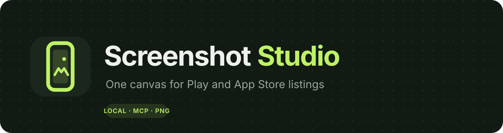

# assets-toolbox

<p align="center">
  
</p>

Tools for most of a product’s asset needs: React on the web, React Native, React on the server, then Google Play and App Store listing screenshots.

| Package                                                                                                                                     | What it does                                                                                                                                                                                                             |
| ------------------------------------------------------------------------------------------------------------------------------------------- | ------------------------------------------------------------------------------------------------------------------------------------------------------------------------------------------------------------------------ |
| [`@tigawanna/brand-assets`](./packages/brand-assets)                                                                                        | Favicon set plus an OG image from one SVG icon. Optional custom React OG component.                                                                                                                                      |
| [`@tigawanna/social-inspect`](./packages/social-inspect)                                                                                    | Local inspector for any URL: OG tags, favicons, social cards, scored issues, copyable fixes.                                                                                                                             |
| [`@tigawanna/expo-assets`](./packages/expo-assets)                                                                                          | Expo app icon, Android adaptive/monochrome icons, splash, web favicon, notification icon, and an `app.json` fragment from one logo.                                                                                      |
|  [`@tigawanna/screenshot-studio`](./packages/screenshot-studio) | **MCP (experimental).** Local canvas for Google Play and App Store listing screenshots. Boards are SQLite files; clone scene strips per store and export PNGs. Needs **Node.js with `node:sqlite`** (Node 22.12+).       |
| [`@tigawanna/svg-compose`](./packages/svg-compose)                                                                                          | Local SVG compositor. Import SVG files, flatten them into individually editable shapes, group/ungroup, draw basic shapes, then export SVG or PNG.                                                                        |
| [`@tigawanna/cabra-sound`](./packages/cabra-sound)                                                                                          | Web Audio sound engine: 182 procedurally generated UI sounds, persistent volume/mute, offline waveforms and WAV export. Includes a self-contained demo sound board, launchable with `npx @tigawanna/cabra-sound studio`. |

> `@tigawanna/cabra-sound` sound designs are based on [Bencho](https://github.com/cabralorenzo/bencho/tree/main/sounds) by cabralorenzo.

> [!WARNING]
> **The MCP endpoint in `screenshot-studio` is experimental and not production ready.** Tool names and schemas may change, there is no authentication, and CORS is open. Keep it bound to `127.0.0.1` and treat boards as disposable. See the [MCP guide](./packages/screenshot-studio/docs/mcp.md).

## Commands

```bash
pnpm install
pnpm build
pnpm test
pnpm check-types
pnpm lint
pnpm format
pnpm check-exports
pnpm quality
```

```bash
pnpm --filter @tigawanna/brand-assets build
pnpm --filter @tigawanna/social-inspect dev
pnpm --filter @tigawanna/expo-assets build
pnpm --filter @tigawanna/screenshot-studio dev
pnpm --filter @tigawanna/svg-compose dev
```

## Desktop app

`apps/desktop` is a Wails + Go application with a React 19 and TanStack Router
frontend. SVG Compose, Social Inspect, Cabra Sound, and Screenshot Studio are
working desktop routes; Brand Assets and Expo Assets have reserved routes and
integration plans.
The shell keeps the original light/dark theme and card design, uses one React
root, and imports the canonical React package sources instead of maintaining
Svelte translations or copied package UIs. The previous Svelte implementation is
preserved read-only at `apps/desktop-svelte` for reference.

```bash
pnpm run desktop:dev
pnpm run desktop:build

# Browser-only frontend work
pnpm --filter @assets-toolbox/desktop dev
```

The executable is written to `apps/desktop/build/bin/assets-toolbox`. The generic
`pnpm build`, `pnpm dev`, and `pnpm test` scripts exclude the native desktop target
so web-only environments do not need Go, GTK, or WebKitGTK. Turborepo discovers the
Go module through `go.work`; the explicit desktop commands build the React frontend
and native binary in one task graph:

```bash
pnpm exec turbo run build --filter=desktop
pnpm exec turbo run test --filter=desktop
pnpm exec turbo run lint --filter=desktop
```

See [`apps/desktop/README.md`](./apps/desktop/README.md) for prerequisites,
architecture, and the package integration workflow.

## Quick use

```bash
npx @tigawanna/brand-assets --icon ./public/logo.svg --out ./public \
  --title "My site" --component ./src/og/OgImage.tsx

npx @tigawanna/social-inspect https://example.com

npx @tigawanna/expo-assets --icon ./logo.svg --out ./assets/images \
  --brand-color '#0f100f' --splash-bg '#ffffff' --image-width 200

pnpm --filter @tigawanna/screenshot-studio dev
# http://127.0.0.1:4320  ·  MCP http://127.0.0.1:4320/mcp
npx @tigawanna/screenshot-studio
```

Screenshot studio boards default to `.screenshot-studio/projects/`. See the [package README](./packages/screenshot-studio/README.md).

`svg-compose` is a client-only app at http://127.0.0.1:4330 — import SVGs by file picker or drag/drop, and see the [package README](./packages/svg-compose/README.md) for the flatten/detach workflow and shortcuts.

## Usage guides

Each package ships its own detailed guide in the npm tarball:

- [brand-assets](./packages/brand-assets/docs/usage.md) — CLI flags, custom OG component contract, programmatic API
- [expo-assets](./packages/expo-assets/docs/usage.md) — CLI flags, merging the `app.json` fragment, source image prep
- [social-inspect](./packages/social-inspect/docs/usage.md) — CLI, programmatic API, local vs remote URLs, SSRF guard
- [screenshot-studio](./packages/screenshot-studio/docs/usage.md) — editor workflow, board files, export, live updates
- [screenshot-studio MCP](./packages/screenshot-studio/docs/mcp.md) — experimental agent endpoint, tools, and limitations

Release notes live in each package's `CHANGELOG.md`.

## Publishing

`@tigawanna/brand-assets`, `@tigawanna/cabra-sound`, `@tigawanna/expo-assets`, `@tigawanna/social-inspect`, and `@tigawanna/screenshot-studio` are public scoped packages (`publishConfig.access: "public"`). Their tarballs include the built `dist`/`.output`, `docs/`, `LICENSE`, and `CHANGELOG.md`. `svg-compose` is `private: true` and remains a local-only app.

From a clean checkout:

```bash
pnpm install
pnpm build
pnpm check-types
pnpm check-exports
pnpm test

pnpm --filter @tigawanna/brand-assets publish
pnpm --filter @tigawanna/expo-assets publish
pnpm --filter @tigawanna/social-inspect publish
pnpm --filter @tigawanna/screenshot-studio publish
```

`prepublishOnly` rebuilds and re-checks exports before each of the library packages is published. Bump versions with `pnpm --filter <package> release` (where available) before publishing.
