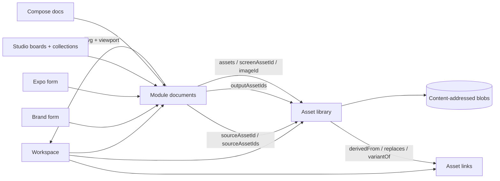

# Global Workspaces — actionable plan

**Status:** proposal, not implemented. Date: 2026-11-27.
**Goal:** one user-created workspace holds every tool's saved state and assets, so a brand mark chosen once can be reused by Expo Assets, Screenshot Studio, SVG Compose, and the OG editor. Workspaces switch instantly and assets can be copied or moved between them.

---

## 0. TL;DR recommendation

1. Add a **new global layer above all tools** called a **Workspace**. Screenshot Studio's current "project/board" and "collections" stay as *Studio documents inside a workspace* — do not rename them globally.
2. Add a **shared asset library per workspace** with durable asset IDs and content-addressed blobs. Replace the current ephemeral `AssetInput.handle` and Studio's inline `data:` assets with references to this library.
3. Persist every tool's editable state as a **module document** in the workspace (`brand`, `expo`, `compose`, `studio`, `sound`, `inspect`).
4. Make `/` a **workspace home / launch screen** with a persistent workspace switcher in the shell, and route tools under `/w/:workspaceId/...`.
5. Implement in five phases, with the native and browser adapters sharing one TypeScript client contract. Do **not** try to migrate everything at once.

---

## 1. What exists today (ground truth)

| Surface | Durable state | Where | Notes |
| --- | --- | --- | --- |
| Screenshot Studio | `StudioSnapshot` = `{ board: BoardRow, nodes, events, assets }`; `SceneCollection[]` inside `board.collections`; `AssetRow { id, name, mime, data }` with `data` a data URL | Standalone: SQLite `<root>/projects/<id>.sqlite`; embedded desktop: IndexedDB `assets-toolbox-screenshot-studio`, store `projects` | Board = project (1:1). "Collections" are scene strips **inside** a board, not workspaces. No cross-project move/copy exists; clone creates a new project. |
| SVG Compose | `WorkspaceDocument { id, name, svg, viewport, updatedAt }` | Wails: `<UserConfigDir>/assets-toolbox/svg-compose/workspace.json`; Node: `.svg-compose/workspace.sqlite` | Exactly **one** row (`id = "draft"`). `WorkspaceID()` is a hash of the storage path, not a user project. |
| Brand Assets | All form state, selected icon, OG design, job result in React state | Nothing durable | `assetInputs` handles are in-memory only. Generated files live in temp `assetgen-*` dirs until `DiscardAssetJob`/shutdown. |
| Expo Assets | Same shape as Brand | Nothing durable | Same Go manager, same handles, same temp job roots. |
| Cabra Sound | `cabra-sound`, `cabra-volume`, `cabra-sound:favorites` | `localStorage` | Global, not project-scoped. |
| Social Inspect | `?url=` in the router; report in memory | Nothing durable | Assets are proxied HTTP responses with a 1 h cache. |
| Shell | `assets-toolbox-theme`, `assets-toolbox-sidebar` | `localStorage` | No launch screen; boots to a static `LibraryPage`. |
| Native dialogs | `{"open":"…","save":"…"}` | `<UserConfigDir>/assets-toolbox/dialogs.json` | Shared by Brand + Expo. No directory picker binding exists. |

Key constraints discovered in the code:

- `SelectAssetImage` returns a random 12-byte handle mapped to a path in `App.assetInputs` (memory only). Handles never expire, but die with the process. They are the natural precursor to a durable asset ID, but are **not** a storage model.
- Asset jobs are temp dirs (`os.MkdirTemp`), removed on discard/shutdown. There is no "commit these outputs to a project" step.
- Studio assets are base64 data URLs inside SQLite/IndexedDB; they can be referenced by `BoardFill.imageId`, `SliceBand.imageId`, `DeviceNode.screenAssetId`, and `ShapeNode.imageId`.
- The close-flush protocol is hardcoded: `DesktopModule = "workspace" | "studio"` in both Go and TS.
- The standalone/browser split already uses an adapter: `src/server/fns` is aliased to `src/desktop/browser-fns.ts` (IndexedDB) in desktop builds. Reuse that pattern.

---

## 2. Terminology (settle this before coding)

| Term | Meaning |
| --- | --- |
| **Workspace** | Global, user-created container. Holds a manifest, a shared asset library, and module documents. Example: "Acme Mobile", "Client X". |
| **Module** | One tool's saved state inside a workspace: `compose`, `brand`, `expo`, `studio`, `sound`, `inspect`. |
| **Document** | A module instance. A workspace may have many Studio boards and many Compose docs, but one `brand`/`expo` form by default. |
| **Asset** | A durable, content-addressed file record in the workspace library (source upload, generated output, or export). |
| **Reference** | A pointer from a module field to an asset ID, e.g. `expo.source.icon → a_…`. |
| **Link** | A typed relationship between two assets: `derivedFrom`, `replaces`, `variantOf`. |

**Do not** call Studio boards "projects" in the global UI. The global container is the workspace; a Studio board is a document in it.

---

## 3. Relationship map

### 3.1 Tool-by-tool relationships

| Tool | Produces today | Consumes today | Should reference in the new model |
| --- | --- | --- | --- |
| Brand Assets | favicons, apple icon, webmanifest, `og.png`, custom OG PNG | one chosen mark (SVG/PNG), OG text, colors | `brand.sourceAssetId`; writes outputs as assets with `origin.tool = "brand"` |
| Expo Assets | app/adaptive/splash/favicon/notification icons, config fragment | up to 3 logos (`icon`, `darkIcon`, `tintedIcon`), colors, sizes | `expo.sourceAssetIds.*` — **can point at the brand source asset**; writes outputs as assets, linked `derivedFrom` the source |
| Screenshot Studio | scene-slice PNGs (ZIP), project snapshots | imported images as data URLs | `studio.assets` become asset refs; `screenAssetId`/`imageId` point at the shared library; exports registered as assets |
| SVG Compose | SVG/PNG exports; one SVG draft | pasted/imported SVG or PNG | one compose document per workspace; imported SVG stored as an asset, doc keeps `svg` text |
| Brand OG editor | `og.png` via `ReplaceAssetArtifact` | data URL of selected mark + layers | becomes a normal "custom OG design" module state; exported PNG is an asset linked `replaces` the generated `og.png` |
| Social Inspect | reports, copied metadata | URL | optional saved report document with captured OG image as an asset |
| Cabra Sound | WAV/ZIP downloads | favorites, mute, volume | preferences initially global; optionally workspace-scoped in phase 5 |

### 3.2 Entity diagram



### 3.3 Example flow: brand mark → Expo → Studio

1. User imports `logo.svg` into workspace **Acme Mobile**. Asset `a_logo`, `kind: "source"`.
2. Brand module sets `sourceAssetId = a_logo`, generates icons. Outputs are stored as assets `a_favicon_*`, each with `origin.derivedFrom = a_logo`.
3. Expo module opens and offers "Use workspace brand mark": sets `sourceAssetIds.icon = a_logo` (a reference, **no duplicate blob**). Its outputs link `derivedFrom = a_logo`.
4. Studio board adds `a_logo` to its asset library (reference) and sets a device `screenAssetId` or shape `imageId` to it.
5. Moving `a_logo` to another workspace offers: **copy** (new ID + blob copy, references rewired in the copy), **move** (only if unreferenced here), or **link** (cross-workspace reference, badge + warning).

---

## 4. Target data model

### 4.1 Core types (`apps/desktop/frontend/src/lib/workspaces/types.ts`)

```ts
export type ToolId = "compose" | "brand" | "expo" | "studio" | "sound" | "inspect";
export type WorkspaceId = `w_${string}`;
export type AssetId = `a_${string}`;
export type DocId = string;

export interface WorkspaceSummary {
  id: WorkspaceId;
  name: string;
  updatedAt: string;
  lastOpenedAt?: string;
  path?: string; // native only
  counts: { assets: number; boards: number; docs: number };
}

export interface WorkspaceManifest {
  id: WorkspaceId;
  name: string;
  createdAt: string;
  updatedAt: string;
  settings: { defaultOutDir: string; theme?: "light" | "dark" };
}

export type AssetKind = "source" | "generated" | "export" | "download";

export interface AssetRecord {
  id: AssetId;
  workspaceId: WorkspaceId;
  name: string;
  mime: string;
  bytes: number;
  width?: number;
  height?: number;
  hash: string; // sha256 of bytes
  kind: AssetKind;
  origin?: { tool: ToolId; jobId?: string; derivedFrom?: AssetId };
  tags: string[];
  refs: AssetRef[];
  createdAt: string;
}

export interface AssetRef {
  module: ToolId;
  docId?: string;
  field: string; // "source.icon", "nodes.n1.screenAssetId", …
}

export interface AssetLink {
  from: AssetId;
  to: AssetId;
  type: "derivedFrom" | "replaces" | "variantOf";
}

export interface ModuleRecord<T = unknown> {
  workspaceId: WorkspaceId;
  module: ToolId;
  docId: DocId;
  data: T;
  updatedAt: string;
}
```

Module payloads:

```ts
interface BrandModuleData {
  sourceAssetId: AssetId | null;
  form: BrandForm;        // plate, copySvg, og*, manifest*, outDir
  ogDesign?: OgDesignResult;
  outputAssetIds: AssetId[];
}

interface ExpoModuleData {
  sourceAssetIds: { icon?: AssetId; darkIcon?: AssetId; tintedIcon?: AssetId };
  form: ExpoForm;         // colors, sizes, flags, outDir
  outputAssetIds: AssetId[];
  configAssetId?: AssetId;
}

interface StudioBoardData {
  // reuse StudioSnapshot shapes; assets become references, not inline data URLs
  board: BoardRow;        // includes SceneCollection[]
  nodes: StudioNode[];
  events: EventRow[];
  assetIds: AssetId[];
}

interface ComposeDocData {
  id: DocId;
  name: string;
  svg: string;            // existing stage inner-HTML format
  viewport: StageViewport;
}
```

### 4.2 On-disk layout (native)

```text
<UserConfigDir>/assets-toolbox/
  dialogs.json                       # unchanged
  workspaces.json                    # registry: WorkspaceSummary[]
  workspaces/
    w_<id>/
      workspace.json                 # WorkspaceManifest
      assets/
        index.json                   # AssetRecord[] + AssetLink[]
        blobs/<aa>/<sha256>          # immutable, deduped by hash
      modules/
        brand.json
        expo.json
        compose/<docId>.json         # multiple docs
        studio/boards/<docId>.json   # one per board (was one .sqlite per project)
        studio/index.json
        sound.json
        inspect/<docId>.json         # optional
      exports/                       # optional saved ZIP/PNG copies
```

Rationale: one folder per workspace makes a workspace portable (zip the folder), keeps blobs deduped by hash, and mirrors the existing atomic-write pattern from `apps/desktop/workspace.go`.

### 4.3 Browser/dev parity

Implement the same contract twice behind `WorkspaceClient`:

- **Native client** — HTTP `/api/workspaces*` for metadata/JSON; Wails bindings only for native-only operations: `PickWorkspaceFolder`, `ImportFileAsAsset(path)`, `ExportAsset(path)`.
- **Browser client** — IndexedDB database `assets-toolbox-core`, stores `workspaces`, `assets`, `blobs` (Blob values, not base64 strings), `modules`. Reuse the Studio adapter idea (`navigator.locks` per workspace/document). Keep `/api/workspace` as a compatibility alias to the default workspace's compose doc until phase 3.

The browser preview must keep working (it now supports image picking for previews) — generation stays native-only.

---

## 5. Launch screen and switching UX

### 5.1 Launch screen (`/` replaces `LibraryPage`)

```text
┌──────────────────────────────────────────────────────────────────────┐
│ Assets Toolbox                 [Workspace: Acme Mobile ▾]  [+ New]  │
├──────────────────────┬───────────────────────────────────────────────┤
│ WORKSPACES           │ Acme Mobile                                   │
│  • Acme Mobile  ●    │ Updated 2h ago · 42 assets · 3 boards          │
│  • Side Project      │                                               │
│  • Client X          │ Open:  [Studio] [Brand kit] [Expo] [Compose]  │
│  …                   │                                               │
│  [+ New workspace]   │ Shared assets (recent)                        │
│                      │ [logo] [favicon] [hero] [og]  → Library       │
│                      │                                               │
│                      │ Recent documents                              │
│                      │ • Launch screens (Studio)   12 min ago        │
│                      │ • App icons (Expo)           yesterday        │
└──────────────────────┴───────────────────────────────────────────────┘
```

- The active workspace is shown in the header everywhere, with a dropdown listing workspaces + "New workspace" + "Manage…".
- The tool catalog (`lib/catalog.ts`) becomes a "Tools" section scoped to the active workspace rather than a static global grid.

### 5.2 Routing and switching

- Routes: `/w/:workspaceId`, `/w/:workspaceId/brand`, `/w/:workspaceId/expo`, `/w/:workspaceId/compose`, `/w/:workspaceId/studio`, `/w/:workspaceId/studio/board/:docId`, etc.
- Keep old routes as redirects to the active workspace so bookmarks don't break.
- Switching workspaces:
  1. Ask the active module to flush (reuse `DesktopFlushProvider`; add `core` as a new `DesktopModule`).
  2. Update `activeWorkspaceId` in the registry and `lastOpenedAt`.
  3. Navigate to the same tool under the new workspace ID and force a route remount (key on `workspaceId`) so no stale state leaks.
  4. Toast: "Switched to Client X".
- A workspace switcher also lives in the collapsed sidebar (icon + tooltip) so it is reachable from every tool.

### 5.3 Move / copy between workspaces

In the shared asset library, select assets → **Move to workspace…**:

- **Copy** (default): create new asset records with new IDs in the target, copy blobs, optionally copy derived outputs. Source stays intact.
- **Move**: allowed only when the asset has no references in the source workspace; otherwise the UI explains what still uses it and offers Copy or Link.
- **Link**: add a cross-workspace reference (`workspaceId` stays on the source asset), shown with a badge. Deleting the source warns about broken links.
- Derived assets: offer "include outputs derived from this source" (e.g. moving a brand mark also moves its favicons and Expo outputs).
- Rewiring: any selected module document that is also copied gets its `sourceAssetId`/`outputAssetIds`/`assetIds` rewritten to the new IDs.

---

## 6. API surface

### 6.1 HTTP (all clients)

```text
GET    /api/workspaces
POST   /api/workspaces                 { name }
GET    /api/workspaces/:id
PATCH  /api/workspaces/:id             { name?, settings? }
DELETE /api/workspaces/:id             { transferTo?: id }

GET    /api/workspaces/:id/assets
POST   /api/workspaces/:id/assets      { name, mime, base64 } | { importPath } (native)
GET    /api/workspaces/:id/assets/:assetId/blob
PATCH  /api/workspaces/:id/assets/:assetId { name?, tags? }
DELETE /api/workspaces/:id/assets/:assetId
POST   /api/workspaces/:id/assets/move { assetIds, targetWorkspaceId, mode: copy|move|link, includeDerived }

GET    /api/workspaces/:id/modules/:module
PUT    /api/workspaces/:id/modules/:module/:docId  { data }
DELETE /api/workspaces/:id/modules/:module/:docId
```

### 6.2 Wails bindings (native-only file operations)

`PickWorkspaceFolder`, `ImportFileAsAsset`, `ExportAsset`, `ExportWorkspaceBundle`.

### 6.3 Events / flush

- Extend `DesktopModule` to `"workspace" | "studio" | "core"`.
- Add Go subscriptions for `core:active`, `core:inactive`, `core:flushed` in `App.startup`, and include `core` in `beforeClose`'s flush cycle.
- Register a `core` flush in `DesktopFlushProvider` that saves all dirty workspace/module state.

---

## 7. Migration strategy

| Existing data | Migration |
| --- | --- |
| Studio IndexedDB projects | On first run, create a default workspace "My Studio" and import each `StoredProject` as a studio board via `StudioSnapshot` adapter. Keep the old store read-only as a fallback for two releases; delete only after a verified export. |
| Studio SQLite projects (standalone) | Copy each `projects/<id>.sqlite` into the new workspace's `studio/boards/<id>.json`; keep the original file untouched. |
| SVG Compose `workspace.json` / `draft` | Import as `compose` doc `doc_main` in the default workspace. Keep `/api/workspace` mapped to that doc so the standalone package keeps working. |
| Brand/Expo in-memory state | Nothing to migrate, but **commit the currently open job's outputs** as assets before discarding on upgrade if a job is alive. |
| `cabra-sound:*` | Keep as global preferences in phase 1; move into `sound.json` per workspace in phase 5 with a "global favorites" toggle if needed. |
| `dialogs.json` | Unchanged. |
| `assets-toolbox-theme` / sidebar | Unchanged global settings. |

Migration must be idempotent and write a marker in `workspaces.json` (`schemaVersion`).

---

## 8. Phased implementation

### Phase 1 — Core store, registry, launch screen (no tool changes)

- [ ] Add `lib/workspaces/types.ts`, `lib/workspaces/client.ts` (interface), `lib/workspaces/native-client.ts`, `lib/workspaces/browser-client.ts`.
- [ ] Go: `apps/desktop/workspaces.go` — registry, manifest, atomic writes, HTTP handlers; register routes in `main.go`'s `apiRoutes`.
- [ ] Add `core` to the flush protocol in `apps/desktop/app.go` and `lib/desktop.ts` / `lib/flush.tsx`.
- [ ] Build `WorkspaceHome` replacing `LibraryPage` at `/`; add `WorkspaceSwitcher` to `AppShell` (header + collapsed sidebar).
- [ ] Add `/w/:workspaceId/*` route tree with redirects from legacy paths.
- [ ] Tests: Go registry CRUD + restart persistence; browser client IndexedDB CRUD; switcher flush ordering.
- **Done when:** create/rename/delete/switch workspaces works in both builds and data survives restart.

### Phase 2 — Shared asset library + Brand/Expo wiring

- [ ] Asset records, blob store by SHA-256, `POST /assets`, blob GET, `ImportFileAsAsset`.
- [ ] Replace `AssetInput.handle` usage in Brand/Expo routes with `AssetId` refs; keep the Go handle map only inside a generation request (resolve asset → temp staged file).
- [ ] Add "Use workspace brand mark" in Expo; persist both forms as module documents (autosave debounce, same pattern as Compose).
- [ ] Commit generated job outputs into the asset library **before** `DiscardAssetJob`; show them in a flat list referencing assets.
- [ ] Tests: dedupe by hash; output commit; cross-tool reference resolves; generation still native-only.
- **Done when:** a mark imported once can drive Brand and Expo, and both tools reopen with their form and outputs intact.

### Phase 3 — Compose + Studio migration

- [ ] Compose: document list, per-workspace docs, keep `/api/workspace` compatibility alias.
- [ ] Studio: `StudioSnapshot` ↔ module document adapter; board list from workspace; asset library references replace inline data URLs (keep `data:` fallback for old snapshots).
- [ ] OG editor: exported PNG becomes an asset with `replaces → generated og.png`.
- [ ] Social Inspect: optional saved reports as `inspect` documents.
- [ ] Tests: Studio round-trip, old snapshot migration, compose draft migration.
- **Done when:** every tool's state lives in the workspace; no tool writes ad-hoc `localStorage` except global theme/sidebar.

### Phase 4 — Move/copy/link + workspace bundle

- [ ] `POST /assets/move`, reference audit, derived-assets inclusion.
- [ ] `ExportWorkspaceBundle` (ZIP of manifest + modules + assets) and import.
- [ ] Conflict handling when importing a bundle with colliding IDs/hashes.
- [ ] Tests: copy/move/link with references; bundle round-trip.
- **Done when:** assets and outputs can be moved between workspaces without dangling references.

### Phase 5 — Polish and scope decisions

- [ ] Per-workspace sound preferences (optional) with global fallback.
- [ ] Workspace templates ("Blank app", "Marketing site") that prefill module defaults.
- [ ] Docs: update `README.md`, `docs/usage.md` in Studio, and this plan's status.
- [ ] Remove the compatibility aliases once no package depends on them.

---

## 9. Risks, decisions, open questions

| Risk / question | Recommendation |
| --- | --- |
| Studio's `AssetRow.data` is a base64 data URL; large images can blow IndexedDB quota. | Store Blobs in the browser adapter and blobs on disk natively; keep `data:` only as a migration fallback. |
| Generated job roots are deleted on discard. | Add an explicit "commit to workspace" step in phase 2; never treat a job ID as durable. |
| Handles are process-local and never expire. | Keep them only as request-scoped temp paths; all durable identity moves to `AssetId`. |
| Cross-workspace references can break when a source workspace is deleted. | Default to copy; link is opt-in with a badge; deletion warns and lists affected workspaces. |
| Studio already owns "projects" and "collections". | Keep those names inside Studio. Global UI says workspace / board / scene strip. |
| SVG Compose standalone has its own `/api/workspace`. | Keep as a compatibility alias to the default workspace's compose doc; remove only after phase 3. |
| Wails has no directory picker today. | Add `PickWorkspaceFolder` in phase 1 if "open workspace folder" is wanted; otherwise defer. |
| 8 MB input / 16 MiB artifact limits. | Keep; asset library enforces the same limits at import. |
| Naming of the default workspace. | `"My Workspace"` created on first run; all existing data migrates into it. |

**Decisions to confirm before phase 1:**
1. Is a workspace allowed to contain multiple Compose docs and multiple Studio boards (recommended: yes), or exactly one of each?
2. Should `sound` favorites be global or workspace-scoped? (recommended: global in phase 1, optional per-workspace later.)
3. Should cross-workspace **link** be supported at all, or copy/move only? (recommended: copy + move in phase 4, link behind a warning.)

---

## 10. Reuse inventory (what we do not need to rebuild)

- `assetgen.Manager` + sidecar protocol — keep for generation; add a commit-to-workspace step.
- `assetgen` path validation (`resolveInRoot`, `normalizeOutDirChecked`) — reuse for asset blob access.
- `workspaceStore.save()` atomic 0600 write pattern from `apps/desktop/workspace.go`.
- `dialogs.json` — keep for last folders.
- Studio's adapter split (`server/fns` ↔ `browser-fns.ts`) and `navigator.locks` serialization.
- Studio's `StudioSnapshot`, `ProjectSummary`, `BoardRow`, `SceneCollection`, `AssetRow` shapes as the basis for studio module data.
- `DesktopFlushProvider` + Go close handshake — extend with `core`.
- The browser `selectWebImage()` fallback added for previews — reuse as the browser asset-import path.
