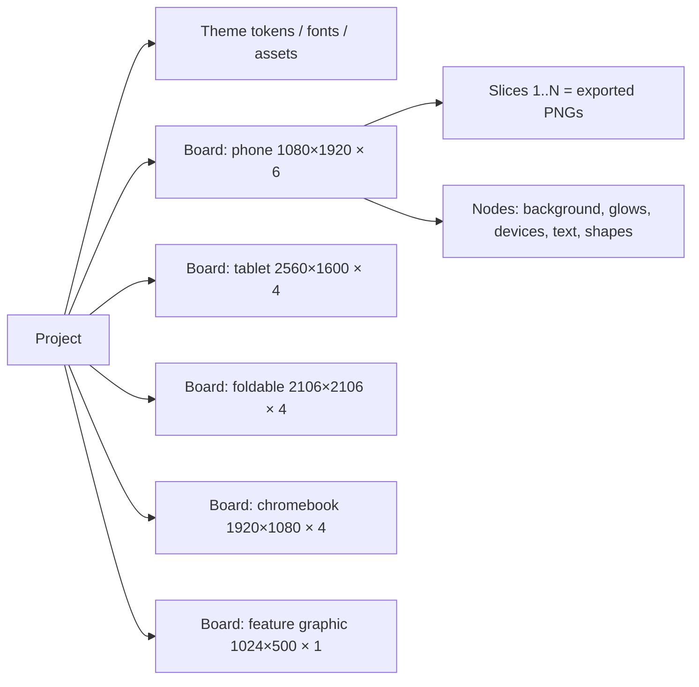
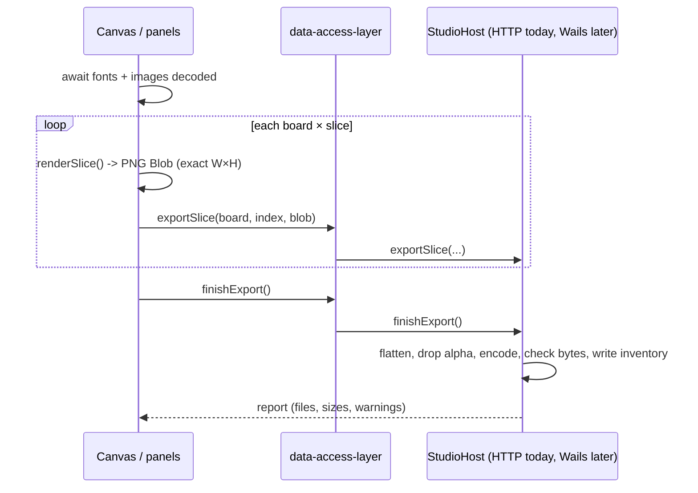

# Plan: Store Studio — a template-driven screenshot editor for Play and the App Store

> Strategy doc. The implementing agent owns the busy work (types, wiring, tests).
> The earlier CLI-only plan is kept in [`PLAN-cli.md`](./PLAN-cli.md). Its **Phase 1 (validation + JPEG)**
> and the **Play policy** section are still required; its Takumi "frame mode" (phases 2–4, 6) is
> **superseded** by this document.

## TL;DR

Build **Store Studio**: one local React editor, launched with `npx @tigawanna/store-studio`, for
both Google Play and the Apple App Store. A project targets one store (`store: "play" | "app-store"`),
and the same editor, canvas and templates serve both. In it:

1. A **board** is one continuous wide canvas cut into N **slices**. Each slice is exported as one Play
   screenshot. Backgrounds, glows and tilted devices can run across slice edges, which gives the
   "fades into the next one" look from the reference image (one sunset sky across five shots, with
   phones crossing the cuts).
2. You can drop in **devices**: phone, tablet, foldable (open and folded), and desktop (Chromebook
   laptop or browser window). A real-device screenshot is **pinned** to the device screen. It
   follows the device when you move, rotate or scale it, and the editor always shows a clear
   outline of where the capture gets cropped.
3. **Templates** generate a fully editable board from copy, a palette and screenshots. One template
   **family** covers every form factor (phone, tablet, foldable, Chromebook, feature graphic), so a
   listing looks consistent everywhere Play now asks for large-screen assets.
4. Export writes store-legal PNGs plus an inventory. Play reuses `@tigawanna/play-screenshots`;
   the App Store gets a sibling package `@tigawanna/appstore-screenshots` in the same shape
   (section 14).
5. The two reference skills get **re-exposed with credit**. An agent can write a project file
   (template + copy), and a human finishes it in the editor.

Stack: **Vite + React 19 + react-konva + TanStack DB + zustand + zod + Tailwind/Radix**.

- **TanStack DB** holds the document (boards, nodes, assets) and drives the canvas and panels
  through live queries.
- **Zustand** holds session state only: selection, zoom and pan, the active tool, and the undo
  stack.
- **All disk and host access goes through `src/data-access-layer/`.** The UI never calls `fetch`
  or a desktop binding directly. Today the data access layer talks to a small local Hono server;
  the same interface is what a future Wails build implements in Go (section 15). This mirrors the
  split in `agentic-json-resume`.

We use React instead of SolidJS because of react-konva's `Transformer`, group clipping, and
per-region export. Nothing comparable is mature in Solid.

---

## 1. Why an editor (and not more one-off skills)

The references ([play-store-screenshots](https://github.com/mobile-dev-ci/play-store-screenshots),
[app-store-screenshots](https://github.com/ParthJadhav/app-store-screenshots)) generate a static
`index.html` + `config.js` per app. They work well for a first draft but hit limits:

| Limitation in one-off skills                           | Studio answer                                       |
| ------------------------------------------------------ | --------------------------------------------------- |
| One fixed layout (`text-top`, `full-bleed`)            | Templates are a starting point; every node editable |
| Each slide is an isolated DOM node                     | Board = continuous canvas, slices are crop windows  |
| Crop of the screenshot is invisible until export       | Ghosted overflow + dashed outlines, live crop %     |
| No rotation/tilt of devices                            | Device group transform, screenshot pinned inside    |
| Phone-first; tablet/foldable/desktop are afterthoughts | Template families emit every Play form factor       |
| `html-to-image` double-call hack for export            | Konva offscreen stage, deterministic per-slice PNG  |

We keep the parts they do well: discovery questions, copy formulas, colour extraction from
screenshots, the neutral CSS-style device mockup proportions, and the QA checklist. Those go into
our skill (section 10) with attribution.

---

## 2. Package layout

New workspace package. It stays separate from `play-screenshots` so the CLI keeps a small
dependency tree (sharp only) and the editor brings React/Konva.

```
packages/
  play-screenshots/        existing CLI + library (Play presets, fit mode, policy checks, inventory)
  appstore-screenshots/    NEW sibling — App Store presets, policy checks, inventory (section 14)
  store-studio/            NEW — the editor + the local server, bin: store-studio
```

`store-studio` depends on both libraries (`workspace:*`). `play-screenshots` must export
`PLAY_STORE_PRESETS`, `getPreset`, `assertPlayBounds`, the pure policy checks from PLAN-cli phase 1,
and an inventory builder (`buildInventory(assets)`, pulled out of `generate.ts`). Keep those checks
**pure**: no `sharp`. Byte-level work (flatten, alpha, file size) stays in the host, because `sharp`
cannot run inside the Wails webview (section 15).

```
packages/store-studio/
  package.json              bin { "store-studio": "./dist/cli.mjs" }, files: dist
  index.html
  vite.config.ts            builds the SPA into dist/app (base path must work under Wails)
  tsdown.config.ts          builds server/ into dist/cli.mjs
  server/                   HTTP host ONLY. The UI never imports from here.
    cli.ts                  `store-studio [projectDir] --port 5177 --open`
                            `store-studio render <project.json> [--board phone]` (phase 6)
    server.ts               Hono app: static SPA + /api/*
    project-io.ts           read/write project.json, copy assets in, schema migrate
    export.ts               slice PNGs -> sharp flatten -> byte checks -> write -> inventory
    watch.ts                chokidar on project dir -> SSE "project-changed"
  src/
    main.tsx  App.tsx
    data-access-layer/      the ONLY code allowed to touch a host. See section 15.
      host/
        types.ts            StudioHost interface
        http.ts             fetch implementation (the Hono server)
        wails.ts            Wails binding implementation (stub until the desktop app)
        memory.ts           in-memory fake, used by tests and Storybook
        index.ts            getHost() picks the implementation
      project/              load, save, migrate — calls the host
      assets/               import, urls — calls the host
      export/               send slices, finish — calls the host
      collections.ts        TanStack DB collections; their queryFns call the DAL, never the host
    model/
      schema.ts             zod schema = single source of truth (also emits JSON Schema for agents)
      geometry.ts           slices, transforms, screen rects, crop math (pure, unit-tested)
      migrate.ts
    session/                zustand. Ephemeral UI state only, never the document.
      selection.ts  view.ts (zoom/pan, active board, tool)  history.ts (undo stack)
    canvas/
      StudioStage.tsx       viewport Stage, pan/zoom, layers
      BoardRenderer.tsx     PURE: (board, assets) -> Konva tree. Used by view AND export
      nodes/                DeviceNode, ImageNode, TextNode, ShapeNode, GlowNode, GroupNode
      overlays/             SliceGuides, ScreenCropGhost, SafeZones, SnapGuides, TextCoverage, LintBadges
      interaction/          Transformer config, snapping.ts, hotkeys.ts, screen-edit mode
    devices/
      catalog.ts            device models, parametric dimensions, screen rects, colours
      frames/               PhoneFrame, TabletFrame, FoldableFrame, LaptopFrame, BrowserFrame (Konva vectors)
    templates/
      registry.ts
      families/<family>/{phone,tablet,foldable,chromebook,feature}.ts
    panels/                 BoardTabs, SliceStrip, Layers, Assets, Inspector/*, TemplateGallery,
                            ExportDialog, StorePreview, LintPanel
    render/
      renderSlice.ts        offscreen Stage -> exact-size PNG Blob
      fonts.ts              FontFace loading, await before any draw/export
      palette.ts            dominant/accent colour extraction from screenshots
  skills/store-studio/
    SKILL.md
    CREDITS.md
```

**Import rule, enforced with oxlint** (scoped so it fails the build): `src/canvas`, `src/panels`,
`src/templates`, `src/devices`, `src/session` and `src/render` may import from
`src/data-access-layer` and `src/model` only. They may not import `src/data-access-layer/host/*`
implementations, `server/`, or reference `fetch`, `XMLHttpRequest`, `window.go` or
`window.runtime`. Only `src/data-access-layer/host/` may.

---

## 3. Core concepts

### 3.1 Project → boards → slices



- **Board** = one Play preset (from `sizes.ts`) × `sliceCount`. Board coordinates are **output
  pixels**: slice `i` covers `x ∈ [i·W, (i+1)·W)`, `y ∈ [0, H)`. With no unit conversion there are
  no rounding bugs at export.
- **Slices are views, not containers.** Nodes belong to the board, not to a slice. A phone at
  `x = 1.6·W` rotated 12° sits across slices 2 and 3, and both PNGs contain their half. This is
  the core idea behind the continuous look.
- Slices can be reordered (drag in `SliceStrip`). Reordering moves the slice _window_ along with
  the nodes whose centre lies inside it, shifted by `ΔW`. Nodes that straddle the cut get a
  prompt: keep left, keep right, or keep in place.
- Inserting or deleting a slice shifts every node to its right by ±W.

### 3.2 Node types

| Node     | Purpose                                              | Notes                                                                            |
| -------- | ---------------------------------------------------- | -------------------------------------------------------------------------------- |
| `device` | Frame + pinned screenshot                            | See section 4. The main feature.                                                 |
| `image`  | Free image (icon, illustration, mountain silhouette) | Optional mask: rect / rounded / ellipse / fade gradient                          |
| `text`   | Label, headline, subtext                             | Konva.Text; tokens for colour/font; `role` for linting                           |
| `shape`  | rect / ellipse / blob path / line                    | Fill = solid / linear / radial gradient, all token-aware                         |
| `glow`   | Soft orb (the references' blurred circles)           | **Radial gradient to transparent, not a blur filter.** Looks the same at no cost |
| `fade`   | Gradient overlay (`colour → transparent`)            | Fades a device bottom into the background, or bridges two slices                 |
| `group`  | Grouping, locking, shared transform                  |                                                                                  |

There is a board-level `background` (solid / linear / radial / image, spanning the **whole
board**). That makes the reference's continuous sky a single gradient.

### 3.3 Theme tokens

Colours and fonts are referenced as `{ token: "primary" }` or as literals. Changing the palette in
the inspector re-themes every board. `palette.ts` proposes tokens from the uploaded screenshots
(k-means on a downscaled canvas: dominant toolbar colour → `primary`, the most saturated
minority colour → `accent`), copying "derive colours, don't ask" from the Play skill.

Device frame colours are **never** tokens. Only neutral sets (black / white / silver) are
allowed, a rule taken from the skill.

---

## 4. Devices and pinned screenshots

### 4.1 Catalog (vector, parametric, no Google device art)

All frames are drawn with Konva primitives (rounded rects, circles, paths), so they stay sharp at
any export size and carry no licensing questions. Each model defines:

```ts
interface DeviceModel {
  id:
    | "phone-punch"
    | "phone-flat"
    | "tablet"
    | "foldable-open"
    | "foldable-cover"
    | "laptop"
    | "browser"
    | "monitor";
  formFactor: "phone" | "tablet" | "foldable" | "desktop";
  /** Frame size in device-local units (scaled by the node transform). */
  frame: { w: number; h: number; radius: number; bezel: number };
  /** Screen rect inside the frame, local units. The screenshot clips to this. */
  screen: { x: number; y: number; w: number; h: number; radius: number };
  /** Drawn ABOVE the screenshot: punch hole, hinge crease, notch, browser chrome. */
  overlays: OverlaySpec[];
  /** Default screen aspect; can switch to "match capture" (4.3). */
  screenAspect: number;
  colours: Record<"black" | "white" | "silver", { frame: string; edge: string; screenBg: string }>;
}
```

| Model            | Screen aspect (default) | Details                                                                                                      |
| ---------------- | ----------------------- | ------------------------------------------------------------------------------------------------------------ |
| `phone-punch`    | 9:20                    | Proportions from the Play skill mockup (radius 0.12w, inset 0.03w, punch hole 0.028w), optional side buttons |
| `tablet`         | 16:10, rotatable        | Thin uniform bezel, front camera on long edge                                                                |
| `foldable-open`  | ~6:5 (inner)            | Vertical **hinge crease** overlay (subtle gradient line), optional slight V-angle later                      |
| `foldable-cover` | ~10:21                  | Narrow outer display                                                                                         |
| `laptop`         | 16:10 or 16:9           | Screen lid + trapezoid keyboard deck, for the Chromebook board                                               |
| `browser`        | free                    | Window chrome (traffic lights / tabs bar), for desktop/web-ish shots                                         |
| `monitor`        | 16:9                    | Bezel + stand                                                                                                |

### 4.2 Pinning model

A device node is a Konva `Group`: `[frame back] → [screen clip group → screenshot image] → [overlays] → [frame edge]`.
The screenshot lives in **screen-local space**, so moving, rotating or scaling the group cannot
un-pin it.

```ts
interface ScreenContent {
  assetId: string;
  fit: "cover" | "contain" | "fill";
  /** Pan of the image centre relative to screen centre, in screen-normalised units (-1..1). */
  offset: { x: number; y: number };
  /** Extra zoom on top of fit scale. 1 = exact cover/contain. */
  zoom: number;
  /** Trim captured system bars before fitting (real-device shots). Pixels of source image. */
  trim: { top: number; bottom: number; left: number; right: number };
}
```

Fit math lives in `geometry.ts` (pure and unit-tested):
`scale = (fit === "cover" ? max : min)(screen.w / srcW, screen.h / srcH) * zoom`, with the image
centred and then offset. `srcW/H` are measured after `trim`.

### 4.3 Crop visibility (the "know in advance" requirement)

Three crop levels, each with its own overlay. All overlays sit on a non-exported layer.

1. **Screen crop.** When a device is selected, the part of the screenshot outside the screen is
   drawn at about 25% opacity, with a dashed outline around the full image bounds and a solid
   accent outline on the screen rect. The inspector reads, for example, "Cropping 7.4% top,
   7.4% bottom". If the crop exceeds a threshold (default 3% on any edge), the device gets an
   amber badge with two fixes: **Match capture** (resize the screen to the capture's aspect,
   which rescales the frame) and **Contain**.
2. **Slice crop.** Slice boundaries are always visible as thin lines with slice numbers. The area
   outside the board is dimmed. A device or text that crosses a boundary is outlined on both
   sides of the cut.
3. **Store crop (approximate).** Optional overlay of how Play presents assets: rounded card
   corners on screenshots, the 20% tagline-area guide, and the feature-graphic centre safe zone
   (keep type out of the outer ~8–10% left/right). Label it "approximate". Values come from
   PLAN-cli's policy section and get confirmed against Play Console Help during implementation.

**Screen-edit mode:** double-click a device (or press Enter) to edit the screenshot instead of
the device. Drag pans `offset`, wheel/pinch changes `zoom`, and the trim handles show the source
image's top/bottom bars. Esc exits. The device stays locked during this mode.

### 4.4 Real-device captures

- Drop PNG/JPEG (or a folder) into Assets. Store the original in `<project>/assets/`, record
  intrinsic size, and run `palette.ts`.
- Suggest `trim.top` from the status bar height (detect a uniform band at the top; default
  24dp × density guess). Play policy says no carrier or notification clutter, so the editor
  offers to hide it, and the README tells people to capture with demo mode on.
- Auto-pick a device model by aspect ratio: tall (~2:1) → phone, ~1.6 → tablet,
  ~1.2 or square → foldable-open.

---

## 5. Templates

### 5.1 Shape of a template

A template is a **pure function** that materialises nodes. After that the nodes are ordinary and
the user edits them freely.

```ts
interface TemplateInput {
  appName: string;
  icon?: AssetId;
  palette: ThemeTokens;
  slides: Array<{ label?: string; headline: string; subtext?: string; screenshot: AssetId }>;
}

interface TemplateFamily {
  id: string; // "aurora-panorama"
  name: string;
  credit?: { name: string; url: string }; // shown in gallery for reference-derived layouts
  boards: Partial<Record<BoardKind, (input: TemplateInput, preset: PlayStorePreset) => BoardDraft>>;
}
```

`BoardKind` is `phone | tablet | foldable | chromebook | feature`. The gallery shows live
thumbnails rendered with the user's actual screenshots and palette, using the same
`BoardRenderer`.

### 5.2 Families to ship (in order)

1. **`text-top`** (credit: play-store-screenshots). Label, headline and subtext in the top 32%;
   large phone below with the bottom ~25% bleeding off the canvas; gradient background with
   two glows. This is the safe default.
2. **`aurora-panorama`** (the reference image). One board-wide multi-stop gradient sky, a
   silhouette `image`/`shape` band along the bottom that spans every slice, scattered star dots,
   headline top-left of each slice, and devices **tilted ±8–15° and offset so every other phone
   crosses a slice cut**. The last slide mirrors the first one's paywall/CTA position without CTA
   copy (policy).
3. **`full-bleed`** (credit: play-store-screenshots). Screenshot fills the slice and a `fade`
   from the top carries the text. Use it for at most one slide per set; the template enforces
   this.
4. **`duo-overlap`**. Two devices overlapping across a cut, for comparison/flow slides.
5. **`split-landscape`**. Tablet, Chromebook and foldable-open boards: headline left 40%, device
   right 60%. This is what every family falls back to for landscape presets when it has no
   dedicated layout.
6. **Feature graphic layouts** per family: `icon-left` and `icon-center`, no device mockup
   (Play's advice), focal point centred, kept clear of the safe zone.

### 5.3 Cross-form-factor consistency

"Generate all boards" runs the family once per `BoardKind`, with the same copy, palette and
screenshots, so it **re-lays out instead of scaling**. A 9:16 phone UI must never be letterboxed
into the foldable or tablet slot; the template places the matching device and capture there,
and warns if the user only has phone captures for a large-screen board.

Once a user edits a materialised board it is marked `detached: true`. Regenerating it then
requires confirmation (v1 does not merge). Phase 7 could keep slot IDs on nodes and re-apply only
untouched ones.

---

## 6. Document schema (sketch)

`schema.ts` (zod) is canonical. It produces `schema.json` for agents and editors.

```ts
interface StudioProject {
  version: 1;
  /** Selects presets, device catalog, templates, lint rules and export layout. */
  store: "play" | "app-store";
  app: { name: string; icon?: AssetId };
  theme: { tokens: Record<string, string>; fonts: { heading: FontRef; body: FontRef } };
  assets: Record<
    AssetId,
    { file: string; width: number; height: number; kind: "screenshot" | "image" | "icon" }
  >;
  boards: Board[];
  export: {
    outDir: string;
    format: "png" | "jpeg";
    layout: "flat" | "fastlane" | "deliver";
    locale: string;
  };
}

interface Board {
  id: string;
  kind: BoardKind;
  preset: string; // a preset id from the store's own catalog (section 14)
  sliceCount: number;
  background: Fill;
  /** Agent-authorable: if `nodes` is empty and `source` exists, the studio materialises on open. */
  source?: { family: string; input: TemplateInput };
  detached?: boolean;
  nodes: Node[]; // z-order = array order
  sliceMeta: Array<{ alt?: string; name?: string }>; // alt ≤ 140 chars, used in inventory
}

interface BaseNode {
  id: string;
  name: string;
  type: NodeType;
  x: number;
  y: number;
  rotation: number;
  opacity: number;
  locked?: boolean;
  hidden?: boolean;
  shadow?: { color: ColorRef; blur: number; offsetX: number; offsetY: number };
}
```

`Fill`, `ColorRef` (`string | { token }`) and the per-node props follow from the tables above.
Size lives on the node itself (`width`/`height` for shapes, devices and images, `fontSize` for
text), never as a `scaleX`/`scaleY`. Konva's `Transformer` resizes by changing node scale, and
saving that scale compounds on the next edit. On `transformend`, reset the node scale to 1 and
write the multiplied size back into the document. Assets are referenced by ID, and paths are
relative to the project directory. Saving copies dropped files into `assets/`.

---

## 7. Editor UX

```
┌───────────────────────────────────────────────────────────────────────────────┐
│ App name ▾ | Phone · Tablet · Foldable · Chromebook · Feature  | Preview | Export │
├──────────┬────────────────────────────────────────────────────────┬───────────┤
│ Templates│                                                        │ Inspector │
│ Assets   │      [ 1 ][ 2 ][ 3 ][ 4 ][ 5 ]   ← one board,          │ transform │
│ Layers   │       continuous, slice lines, pan/zoom               │ device    │
│          │                                                        │ screen    │
│          │                                                        │ fill/text │
│          ├────────────────────────────────────────────────────────┤ lint      │
│          │ Slice strip: thumbnails, drag reorder, + / −, alt text │           │
└──────────┴────────────────────────────────────────────────────────┴───────────┘
```

Must-haves:

- **Viewport:** wheel zoom to the cursor, space-drag to pan, "fit board" and "fit slice"
  (1, 2, …), zoom 5–400%.
- **Transform:** Konva `Transformer` with rotation snapping (shift = 15°), proportional scaling
  for devices, multi-select, arrow-key nudge (shift = 10px). The document is plain data; the
  Konva node is only the interaction surface. Read it on `dragend` and `transformend`, never
  during the gesture. Because the stage is zoomed, any manual pointer math (snap guides, the
  slice hover) goes through the inverse stage transform. Dragging itself is handled by Konva.
- **Text editing:** double-click swaps the Konva text for an HTML `textarea` positioned over it.
  Canvas has no caret, selection or IME. Commit the string when the textarea blurs.
- **Snapping:** slice edges and centres, board centre line, other nodes' edges and centres, an
  optional 8px grid. Smart-guide lines render in the overlay layer. Alt disables snapping.
- **Layers:** reorder, lock, hide, rename, group/ungroup.
- **History:** one snapshot of the plain document per finished gesture (section 16.3). A drag is
  one undo step, not one per pointer move. Typing commits when the textarea closes.
- **Autosave:** the data access layer debounces and calls `host.writeProject`. The UI does not
  know whether that is HTTP or Wails. External edits arrive as host events and are merged when
  the document is clean, otherwise shown as a "reload?" banner.
- **Store preview:** renders exported slices as Play would show them, as a carousel of rounded
  cards **with gaps**. This matters because continuous designs read differently with gaps.
  Toggle light/dark Play chrome. The feature graphic is shown in its listing position.
- **Lint panel** (live, clickable to select the offending node):
  - text crossing a slice cut (error)
  - text area > 20% of a slice (warn)
  - banned words (`Best`, `#1`, `Download now`, …, from PLAN-cli)
  - low text contrast against the sampled background (warn)
  - screenshot crop above threshold (warn)
  - phone capture used on a large-screen board (warn)
  - Play section counts: phone 2–8, at least 4 for promotion eligibility, Chromebook 4–8
  - feature graphic content in the safe-zone margins, or a pure white/black fill (warn)
  - alt text missing or > 140 chars

---

## 8. Rendering and export

### 8.1 One renderer

`BoardRenderer` is a pure React component, `(board, assets, theme) → Konva nodes`, with no
editor state. The viewport stage wraps it with interaction and overlays. Export mounts the same
component into an **offscreen** `Konva.Stage` sized exactly `W × H`, with the board offset by
`-i·W`. View zoom therefore never affects output, and we never allocate a 20 000px-wide canvas.
Tablet boards would otherwise exceed browser canvas limits, Safari's ~16.7 MP area cap included.

Layers in the viewport stage: `background` → `content` → `overlays` (`listening: false` where
possible). Large boards use `perfectDrawEnabled = false` on shapes and cache static groups.

### 8.2 Export pipeline



The store libraries run in two places. Pure checks (dimensions, aspect ratio, banned words, alt
length) run in the webview through the data access layer, so both hosts share them. Byte-level
checks (no alpha channel, file size cap) run in the host, because they need `sharp` or, under
Wails, Go image code.

- File names follow the existing convention: `01-phone-portrait.png`, …, `feature-graphic.png`.
  With fastlane layout: `metadata/android/<locale>/images/{phoneScreenshots,sevenInchScreenshots,tenInchScreenshots,…}`.
- Tablet boards write into both the 7" and 10" inventory lists, as `pushPath` already does.
- Export dialog: choose boards, PNG/JPEG, and an optional "also download ZIP" for people who don't
  want files written to disk.

### 8.3 Headless (CI / agents)

`store-studio render project.json` starts the server, opens the built SPA in **Playwright**
headless at `/render?board=…`, and runs the same `renderSlice`. This gives exact parity because
it is the same code and the same Chromium. Konva on Node (node-canvas or skia-canvas) was
considered and rejected for v1: font and filter differences would make the editor preview lie.
Playwright is an **optional peer dependency** that is only needed for `render`.

---

## 9. Host contract

The UI depends on the `StudioHost` interface (section 15), not on HTTP. The Hono server is one
implementation of it. Bind it to `127.0.0.1`, take the project dir from the cwd or an argument,
and refuse any path outside that dir.

| Host method    | HTTP route                | Purpose                                                   |
| -------------- | ------------------------- | --------------------------------------------------------- |
| `readProject`  | `GET /api/project`        | Read + migrate `project.json` (create default if missing) |
| `writeProject` | `PUT /api/project`        | Write (zod-validated)                                     |
| `assetUrl`     | `GET /api/assets/:file`   | Serve project assets                                      |
| `importAsset`  | `POST /api/assets`        | Copy into `assets/`, return intrinsic size                |
| `exportSlice`  | `POST /api/export/slice`  | Receive one rendered slice                                |
| `finishExport` | `POST /api/export/finish` | Byte checks, write files + inventory, return report       |
| `subscribe`    | `GET /api/events`         | SSE: `project-changed`, `assets-changed`                  |

Default project location: `store/studio/project.json`, next to the existing `store/google/`
output. App Store projects export to `store/appstore/` (section 14).

---

## 10. Skills and credits

- Ship `skills/store-studio/SKILL.md`, installable via `npx skills add tigawanna/assets-toolbox`
  (or by copying). The agent flow:
  1. **Discovery.** Ask the Play skill's single question, "top features and the problem each
     solves". Scan for screenshots and the icon.
  2. **Copy.** Use the headline formulas (credited, summarised, not pasted wholesale).
  3. **Author.** Write `store/studio/project.json` with `boards[].source = { family, input }`
     and **no nodes**. Agents pick templates and copy; they do not place pixels. The studio
     materialises the boards on open.
  4. **Hand-off.** Run `npx @tigawanna/store-studio`. The human tweaks the layout and exports. For
     CI, run `store-studio render`.
  5. **QA.** Run the reference skill's checklist, mapped onto our lint rules.
- `CREDITS.md` and the README "Credits" section link both projects and authors and include
  their MIT licence notices for anything adapted (copy formulas, mockup proportions, layout
  names).
- Also mention them as **alternatives** for people who want a zero-dependency one-off.
- **To-do before copying anything:** `references/app-store-screenshots` is an empty clone (no
  commits). Re-clone it, confirm the licence, and only then adapt content.

---

## 11. Phases

Each phase ends with a usable editor and green `test` / `typecheck` in the package. Prerequisite
in `play-screenshots`: **PLAN-cli Phase 1** (`validate.ts`, JPEG) plus the `buildInventory`
extraction and exports.

### Phase 0: spikes (time-boxed, throwaway branch)

- **S1, interaction:** react-konva device group with a rounded clip, rotated and scaled by
  `Transformer`, with the screenshot pinned and the ghost overlay. Confirm hit-testing and
  double-click into screen-edit mode feel right.
- **S2, export parity:** offscreen stage → 1080×1920 PNG. Check the size is exact, the text is
  crisp, and a glow plus a gradient across a slice cut lines up pixel-perfectly between adjacent
  slices (concatenate two slices and diff against a single 2W render).
- **S3, performance:** 8-slice phone board and 4-slice tablet board, with 6 full-res captures,
  at 60fps while dragging. Measure with and without `cache()`.
- **S4, fonts:** Google font via FontFace. Export must wait for `document.fonts.ready` plus an
  explicit `load()`.
- **S5, text and history:** double-click a headline, type through an overlaid `textarea`, and
  confirm one undo step restores the previous string. Then drag a device and confirm the whole
  drag is one step. The mechanism is fixed in section 16.3; this only checks it feels right.

Exit: a short note in this file on what changed. If S2 fails, the fallback is to render the
slice from the full board stage with `toCanvas({x, y, width, height})`.

### Phase 1: skeleton end to end

Package scaffold, the `StudioHost` interface with its HTTP implementation and its in-memory fake,
TanStack DB collections, zod schema, one phone board, background fill, slice guides, a
`phone-punch` device with a pinned screenshot (cover), and export of all slices to `store/google`
through `play-screenshots` validation.
**Done when:** drop a capture, move and rotate the phone across a cut, export, and get two valid
PNGs that each contain half of the phone. The same flow passes against the in-memory host with no
server running, which is what proves the Wails swap is possible.

### Phase 2: editing core

Transformer and snapping, multi-select, layers panel, undo/redo, autosave and SSE reload, text,
shape, glow and fade nodes, inspector, theme tokens, assets panel with upload.

### Phase 3: devices and crop clarity

Full catalog (phone ×2, tablet, foldable open/cover, laptop, browser, monitor), colour variants,
screen-edit mode, trim, ghost overlay, crop % plus badge, "Match capture", auto-pick device by
aspect.
**Done when:** you can tell exactly what part of a 1440×3120 real-device capture survives inside
a tilted foldable before exporting.

### Phase 4: templates

Template registry, gallery with live thumbnails, `text-top` and `aurora-panorama` families for
the phone board plus feature graphic, palette extraction, and agent materialisation from
`source`.

### Phase 5: all form factors and Play readiness

Boards for tablet, foldable, Chromebook and feature graphic; "generate all boards"; the
`split-landscape` fallback; `full-bleed` and `duo-overlap`; store preview with gaps; the lint
panel; per-slice alt text; fastlane layout; ZIP download.

### Phase 6: headless, skill, docs

`store-studio render` via Playwright, `SKILL.md`, `CREDITS.md`, READMEs (both packages
cross-link), and one example project in `examples/` built from generated, not committed-large,
images.

### Phase 7: App Store

Follow section 14. `appstore-screenshots` package, iPhone and iPad device frames with the clean
status bar, App Store boards and template variants, the `deliver` export layout, and the App
Store lint rules. Play projects must keep working unchanged.
**Done when:** the same captures and copy produce a Play phone set and an App Store 6.9" set from
two projects, and both pass their own validation.

### Later (not v1)

- Perspective/3D tilt. Konva is affine only: render the device to an offscreen canvas and
  mesh-warp it with WebGL into an image node.
- Rich text runs (accent-coloured word in a headline).
- Multi-locale copy with RTL. The schema already has `locale`; this would add per-locale text
  overrides.
- Custom device PNG frame import with 4-corner screen calibration.
- Slot-aware template regeneration that keeps user edits.
- The Wails desktop app (section 15). The seam for it is built in phase 1; the Go app is not.

---

## 12. Testing strategy

- **Unit (vitest):** `geometry.ts` (slice ranges, cover/contain/zoom/offset/trim math, crop
  percentages, which slices a rotated rect intersects), template functions (deterministic output
  for fixed input), lint rules, schema migrations.
- **Host:** project I/O round trip, path traversal refused, export writes opaque exact-size
  files (reuse `sharp.metadata()` checks from play-screenshots tests). Run the export flow twice,
  once against the Hono host and once against the in-memory host.
- **E2E (Playwright, phase 6):** load the example project, export, and assert file count, sizes
  and no alpha. Pixel-diff one slice against a golden image with a tolerance.
- Generate source images inside tests. Do not commit large fixtures.

---

## 13. Decisions and risks

| Decision / risk                    | Choice                                                   | Why / mitigation                                                                                                                                       |
| ---------------------------------- | -------------------------------------------------------- | ------------------------------------------------------------------------------------------------------------------------------------------------------ |
| Canvas library                     | **react-konva**                                          | Transformer, clip groups, region export, mature React binding. Fabric's React story is weaker. tldraw is heavy and needs a production licence key      |
| DOM + `html-to-image` (references) | Rejected for the editor                                  | Flaky export (double-call hack), slow transforms on large DOM                                                                                          |
| Blur                               | Radial-gradient glows, not filters                       | Konva filters need `cache()` and are slow on big nodes                                                                                                 |
| Huge boards                        | Export per slice on an offscreen stage                   | Avoids canvas size/area limits                                                                                                                         |
| Headless parity                    | Playwright over the same SPA                             | One renderer. Optional peer dependency                                                                                                                 |
| Device art dating                  | Vector neutral frames + "no device" option everywhere    | Play warns that device imagery dates; the feature graphic has none by default                                                                          |
| Play crop/overlay specifics        | Overlay marked "approximate"                             | Verify against Play Console Help during phase 5; numbers live in one constants file                                                                    |
| Large-screen requirements          | Template families + lint for missing/phone-only captures | Values come from `sizes.ts`; confirm current Play rules before release                                                                                 |
| Reference licences                 | Credit + MIT notices, re-verify app-store-screenshots    | Local clone is empty                                                                                                                                   |
| Document state                     | **TanStack DB** collections + live queries               | Same pattern as `resumes-query-collection.ts`. Panels and canvas stay in sync without hand-written selectors                                           |
| Session state                      | **Zustand** (selection, viewport, tool, undo stack)      | Ephemeral. Not persisted, so it never conflicts with the document                                                                                      |
| Undo                               | Snapshot of the plain document per finished gesture      | The Konva canvas-editor pattern. Snapshots stay small because assets are IDs, not pixels. No zundo, no inverse transactions                            |
| Persistence                        | The host writes `project.json`                           | No OPFS. It is unreliable in the Wails webview, and the resume app's event-sourced OPFS setup exists for multi-device sync, which this app does not do |
| Host access                        | `StudioHost` in `src/data-access-layer/host`             | HTTP now, Wails later, in-memory in tests. Enforced by the oxlint import rule                                                                          |
| Image bytes                        | Host-side (`sharp` in Node, Go image libs under Wails)   | `sharp` cannot run in a webview. Libraries ship pure checks only                                                                                       |
| App Store device art               | Vector approximations, same as Play                      | Do not bundle Apple's device frame artwork (frameit ships it; we don't)                                                                                |

Out of scope: the Expo project (not reviewed yet), emulator and simulator capture (link the
Android CLI screenshot guide and Xcode's simulator screenshot instead), the Mac App Store, and
the Wails application itself. The data access layer is shaped so the Wails app can come later
without changes to the canvas, panels or templates.

---

## 14. App Store

Same editor, second store. A project chooses `store: "app-store"` and everything store-specific
(presets, devices, templates, lint, export layout) follows from that. The canvas, pinning, crop
overlays, templates-as-functions and the data access layer are shared unchanged.

### 14.1 New package: `@tigawanna/appstore-screenshots`

Copy the shape of `play-screenshots`, not its internals. It is a library plus a thin CLI for
fit-mode only (raw simulator capture → exact size, flattened). The editor does the designed
output.

```
packages/appstore-screenshots/
  src/sizes.ts        APP_STORE_PRESETS, getPreset, assertAppStoreBounds
  src/policy.ts       pure checks: alt length, screenshot count per display size (max 10)
  src/inventory.ts    buildInventory() -> the deliver folder layout
  src/cli.ts          fit mode only
```

**Confirm every number below against
[Apple's screenshot specifications](https://developer.apple.com/help/app-store-connect/reference/screenshot-specifications/)
before writing `sizes.ts`, and again before release.** Apple adds display sizes; the code should
read them from one file.

The set to start from, which App Store Connect accepts and scales down from:

| Preset       | Size (portrait) | Display     | Notes                                                                         |
| ------------ | --------------: | ----------- | ----------------------------------------------------------------------------- |
| `iphone-6-9` |       1320×2868 | iPhone 6.9" | The largest iPhone slot. Supplying this covers the smaller iPhones            |
| `iphone-6-5` |       1284×2778 | iPhone 6.5" | Also accepts 1242×2688. Needed only when the app does not run on 6.9" devices |
| `ipad-13`    |       2064×2752 | iPad 13"    | The largest iPad slot. Supplying this covers the smaller iPads                |
| `ipad-12-9`  |       2048×2732 | iPad 12.9"  | Older slot, still accepted                                                    |

Each preset also has a landscape size with the sides swapped. Most apps only need portrait.

Rules to encode, all marked "verify" in the constants file:

- JPEG or PNG, RGB. Flatten alpha on export so the pipeline matches Play, and confirm App Store
  Connect still rejects transparency.
- Up to **10** screenshots per display size, per localization.
- App previews (video) are out of scope.
- No feature graphic equivalent exists. Do not invent one.

### 14.2 What changes versus Play

|               | Play                                                                  | App Store                                                                                                                                                      |
| ------------- | --------------------------------------------------------------------- | -------------------------------------------------------------------------------------------------------------------------------------------------------------- |
| Form factors  | phone, tablet, foldable, Chromebook, feature graphic                  | iPhone, iPad. Mac later                                                                                                                                        |
| Devices       | punch-hole phone, tablet, hinge foldable, laptop, browser             | `iphone-island` (Dynamic Island), `iphone-notch`, `ipad`                                                                                                       |
| Status bar    | Offer to **trim** it (Play dislikes carrier and notification clutter) | Offer to **draw** one: 9:41, full signal, full wifi, full battery, as vectors over the screen. Reviewers and the gallery expect a clean one. Toggle per device |
| Text coverage | Warn above ~20%                                                       | No such rule. Keep the contrast and slice-cut checks                                                                                                           |
| Banned words  | `Best`, `#1`, `Download now`, …                                       | No equivalent list. Drop that lint for App Store projects                                                                                                      |
| Counts        | Phone 2–8, 4+ for promotion                                           | 1–10 per display size. Warn at 0, error above 10                                                                                                               |
| Export layout | flat, or fastlane `metadata/android/<locale>/images/...`              | flat, or fastlane deliver `fastlane/screenshots/<locale>/`                                                                                                     |
| Inventory     | `play-screenshots.config.json`                                        | `appstore-screenshots.config.json`                                                                                                                             |

### 14.3 Devices

Vector frames, same technique as section 4. Proportions approximate the current iPhone and iPad:
continuous corner radius, thin bezel, Dynamic Island as a rounded pill overlay, notch as an
alternative model, iPad front camera as a small circle. **Never bundle Apple's device photos or
the frame PNGs that fastlane frameit distributes.** Those are Apple's artwork. Our frames are
plain vector approximations in neutral black, white and silver, exactly like the Play frames.

The status bar is a separate overlay drawn above the screenshot and below the island, so it stays
pinned when the device is rotated. It is a node prop (`statusBar: "clean" | "hidden"`), not part
of the screenshot, so swapping a capture never loses it.

### 14.4 Templates

The families in section 5 gain an `app-store` variant rather than new families. `text-top` and
`aurora-panorama` already describe a composition; the variant only changes the device model, the
slice size and the status bar default. A family that has no App Store variant falls back to
`text-top`. The gallery filters families by the project's store.

### 14.5 Export

`finishExport` branches on `project.store`. For `app-store` it calls
`@tigawanna/appstore-screenshots` for the inventory and writes:

```
store/appstore/
  01-iphone-6-9.png
  ...
  appstore-screenshots.config.json
```

With `layout: "deliver"`:

```
fastlane/screenshots/en-US/
  iPhone 6.9-01.png
  iPad 13-01.png
```

Check the exact filenames deliver expects in the
[deliver docs](https://docs.fastlane.tools/actions/deliver/) when implementing, and match them
rather than guessing.

---

## 15. Data access layer and the Wails migration

### 15.1 The rule

Everything the editor needs from outside the webview goes through `src/data-access-layer/`. That
is the same boundary `agentic-json-resume` uses, where `resume.functions.ts` is the transport and
`resume.server.ts` is the work, and the collections only call the transport.

Here the transport is a `StudioHost` interface instead of TanStack Start server functions, because
this app has two transports and no server of record.

```ts
// src/data-access-layer/host/types.ts
export interface StudioHost {
  readProject(): Promise<StudioProject>;
  writeProject(project: StudioProject): Promise<void>;
  importAsset(file: File): Promise<AssetRecord>;
  assetUrl(file: string): string;
  exportSlice(input: { boardId: string; index: number; png: Blob }): Promise<void>;
  finishExport(input: ExportRequest): Promise<ExportReport>;
  /** Returns an unsubscribe function. */
  subscribe(listener: (event: HostEvent) => void): () => void;
  /** Native file dialog where the host has one. The HTTP host returns null and the UI uses an <input type="file">. */
  pickFiles?(options: { multiple: boolean; filters: string[] }): Promise<File[] | null>;
}
```

```ts
// src/data-access-layer/host/index.ts
export function getHost(): StudioHost {
  if (typeof window !== "undefined" && "runtime" in window) return wailsHost;
  return httpHost;
}
```

`window.runtime` is what Wails injects into the webview, so detection needs no build flag and the
same Vite bundle runs in the browser and in the desktop app.

### 15.2 What lives where

| Folder                                                          | May call the host              | Contains                                                         |
| --------------------------------------------------------------- | ------------------------------ | ---------------------------------------------------------------- |
| `data-access-layer/host/`                                       | yes, this is the only place    | `http.ts`, `wails.ts`, `memory.ts`                               |
| `data-access-layer/project`, `assets`, `export`                 | through `getHost()` only       | load, save, migrate, import, export, plus the debounced autosave |
| `data-access-layer/collections.ts`                              | no, it calls the DAL functions | TanStack DB collections                                          |
| `canvas`, `panels`, `templates`, `devices`, `session`, `render` | no                             | UI. Reads live queries, calls DAL functions                      |
| `server/`                                                       | n/a, it **is** a host          | Hono routes, `sharp`, disk. Never imported by `src/`             |

The oxlint rule from section 2 enforces this. It is the whole migration strategy: when the desktop
app happens, only `host/wails.ts` and a new Go package change.

### 15.3 The two hosts

**HTTP (`host/http.ts`).** `fetch` to the routes in section 9. Used by `npx` and by Playwright.
`subscribe` uses `EventSource`.

**Wails (`host/wails.ts`).** Calls the generated bindings. Wails generates a JS function per bound
Go method under `wailsjs/go/<package>/<Struct>.js`, and the calls return promises. The methods map
one-to-one onto `StudioHost`:

```go
// apps/store-studio-desktop/studio.go (written when the desktop app is built, NOT in phase 1)
type StudioService struct{}

func (s *StudioService) ReadProject() (string, error)          // project JSON
func (s *StudioService) WriteProject(json string) error
func (s *StudioService) ImportAsset(name string, bytes []byte) (string, error)
func (s *StudioService) ExportSlice(boardId string, index int, png []byte) error
func (s *StudioService) FinishExport(requestJson string) (string, error)
```

Events go the other way through the Wails runtime: Go calls `runtime.EventsEmit(ctx, "host",
payload)` and `wails.ts` listens with `runtime.EventsOn("host", ...)`, which replaces SSE.
`pickFiles` uses the native dialog (`runtime.OpenFileDialog`) instead of an `<input>`.

Until that Go code exists, `wails.ts` exports the same functions throwing "desktop host not
implemented". Keeping the file there means the switch in `getHost()` is real and the import rule
has something to point at.

**Memory (`host/memory.ts`).** Implements `StudioHost` over a `Map`. Tests and the phase 1
acceptance run against it, so the editor is proven host-independent before any desktop work.

### 15.4 Image processing split

`sharp` is a Node native module and will not run in the webview, so it cannot be a shared
dependency of the UI. Split the work:

- **Pure, in the store libraries, runs anywhere:** preset dimensions, aspect-ratio caps, alt
  length, banned words, screenshot counts, inventory paths.
- **Bytes, in the host:** flatten onto the background colour, drop the alpha channel, encode PNG
  or JPEG, measure the file, refuse files over the store's cap.

The HTTP host does the byte work with `sharp`. The Go host does the same work with Go's
`image/png` and `image/jpeg`. Both return the same `ExportReport`, so the UI cannot tell them
apart.

### 15.5 Desktop app layout (later, shown now so the package is shaped for it)

```
apps/store-studio-desktop/        Wails project, added when we build the desktop app
  main.go                          app setup, binds StudioService
  studio.go                        the host operations
  wails.json                       "frontend:build": "pnpm --filter @tigawanna/store-studio build"
  build/                           generated bindings, gitignored
```

There is no second frontend. `wails.json` points its frontend build at the `store-studio` package,
and Wails serves `dist/app`. Requirements for that to work, which phase 1 must already satisfy:

- Vite `base` is relative (`base: "./"`), so assets resolve inside the webview.
- The UI uses hash routing or a single page. Wails serves files, not a history fallback.
- No dependency on `window.location` origin, SSE, or cookies. Events come from `subscribe`.
- Fonts are bundled or loaded from disk through the host. Do not assume Google Fonts CDN is
  reachable from a packaged app. Ship the few default families in `assets/fonts` and let the host
  resolve them.

---

## 16. State: TanStack DB and zustand

Two stores with a hard split. The document is TanStack DB. The session is zustand.

### 16.1 Document: TanStack DB

Model it on `resumes-query-collection.ts` in the resume app: a collection whose `queryFn` calls a
data access layer function, with `useLiveQuery` in components. Do **not** model it on
`data-access-layer/event-sourced/`. That code solves multi-device sync against a server with OPFS
persistence, and this app has neither. OPFS in particular is a bad bet here: the Wails webview on
macOS and Linux uses WebKit, where OPFS support is unreliable, so persistence goes through the
host instead.

Collections:

| Collection | Key        | Source                                                           |
| ---------- | ---------- | ---------------------------------------------------------------- |
| `project`  | singleton  | `readProject()`                                                  |
| `boards`   | `board.id` | derived from the project                                         |
| `nodes`    | `node.id`  | derived from the project; the canvas live query filters by board |
| `assets`   | `asset.id` | derived from the project                                         |

`nodes` as its own collection is what lets the layers panel, the inspector and the canvas all
read the same row and update together. A node move writes that one row.

Writes are optimistic and local. A persistence adapter in `data-access-layer/project` subscribes
to collection changes, debounces (~500ms), serializes back to a `StudioProject`, validates with
the zod schema, and calls `host.writeProject`. Saving is therefore just a consequence of editing.
The adapter is the only thing that knows about the file.

Read-only host data uses the same mechanism: a `presets` collection and a `fonts` collection whose
`queryFn` calls a DAL function, exactly like `resumesCollection`.

### 16.2 Session: zustand

`src/session/` holds selection, viewport (zoom, pan, active board), the active tool, screen-edit
mode, and the transient snap guides. None of it is written to `project.json`. Use the immer
middleware for nested updates.

### 16.3 Undo

Follow the history model from Konva's
[canvas editor tutorial](https://konvajs.org/docs/sandbox/Canvas_Editor.html): a `past / present /
future` stack of plain documents, committed when a gesture finishes.

- `dragmove` and `transform` update the Konva node only. Nothing is written to the collection and
  nothing is pushed to history while the pointer is down.
- `dragend` and `transformend` write the final `x`, `y`, `rotation` and baked size into the `nodes`
  collection, and push the previous document onto `past`.
- A drag across the board is one undo step. Typing commits once, when the textarea closes, not per
  keystroke.
- Undo restores the previous snapshot into the collections. Redo moves the other way.
- Snapshots store asset IDs, never image bytes, so the stack stays small.

The stack lives in the session store. It is not persisted; reloading loses undo, and the file on
disk is always the present. zundo is not used, because the document is not a zustand store and
snapshotting plain data is simpler than recording inverse transactions.

### 16.4 What the resume app is and is not a model for

| Copy                                                                                           | Do not copy                                                                                                   |
| ---------------------------------------------------------------------------------------------- | ------------------------------------------------------------------------------------------------------------- |
| `resume.functions.ts` vs `resume.server.ts`: transport separated from the work it triggers     | `createServerFn` itself. We have two transports, so the interface replaces it                                 |
| `resumes-query-collection.ts`: `queryCollectionOptions` with a `queryFn` that calls the DAL    | The event-sourced collections, OPFS persistence, sync transport, and the recovery code under `event-sourced/` |
| `event-sourced/provider.tsx`: one provider that opens the store and exposes it through context | Its authentication, sync gating and reload-on-error behaviour                                                 |

---

## 17. References for the implementing agent

Read these before writing code. The internal ones show patterns to follow; the external ones are
the source of truth for anything this plan says "verify".

### In this workspace

| Path                                                                                              | What to take from it                                                                                                                                                                                                            |
| ------------------------------------------------------------------------------------------------- | ------------------------------------------------------------------------------------------------------------------------------------------------------------------------------------------------------------------------------- |
| `fullstack/agentic-json-resume/apps/web/src/data-access-layer/resume/resume.functions.ts`         | Transport kept separate from implementation                                                                                                                                                                                     |
| `fullstack/agentic-json-resume/apps/web/src/data-access-layer/resume/resume.server.ts`            | Where the actual data work lives                                                                                                                                                                                                |
| `fullstack/agentic-json-resume/apps/web/src/data-access-layer/resume/resumes-query-collection.ts` | TanStack DB collection whose `queryFn` calls the data access layer. The closest existing pattern                                                                                                                                |
| `fullstack/agentic-json-resume/apps/web/src/data-access-layer/event-sourced/provider.tsx`         | Provider shape only. Do not copy the rest of that folder (section 16.4)                                                                                                                                                         |
| `fullstack/agentic-json-resume/apps/web/src/lib/tanstack/db/`                                     | Their DB helpers, for reference                                                                                                                                                                                                 |
| `npm/assets-toolbox/packages/play-screenshots/src/sizes.ts`                                       | The Play preset catalog to call, not reimplement                                                                                                                                                                                |
| `npm/assets-toolbox/packages/play-screenshots/src/generate.ts`                                    | `buildInventory` has to be extracted from here                                                                                                                                                                                  |
| `npm/assets-toolbox/packages/play-screenshots/PLAN-cli.md`                                        | Validation rules and Play policy: no alpha, 8 MB cap, banned words, alt text length                                                                                                                                             |
| `npm/assets-toolbox/references/play-store-screenshots/skills/play-store-screenshots/SKILL.md`     | Text-top layout numbers, CSS device proportions, copy formulas, filename convention, QA checklist. MIT, Kushal Agrawal. Adapt and credit; do not vendor the HTML generator                                                      |
| `npm/assets-toolbox/references/app-store-screenshots`                                             | Parth Jadhav, [github.com/ParthJadhav/app-store-screenshots](https://github.com/ParthJadhav/app-store-screenshots). **The local clone has no commits.** Re-clone it, read `LICENSE` and `SKILL.md`, and only then adapt content |

### Libraries

| Topic                                                  | Where                                                                                                                                                                                                                                                                                                                                                                                                  |
| ------------------------------------------------------ | ------------------------------------------------------------------------------------------------------------------------------------------------------------------------------------------------------------------------------------------------------------------------------------------------------------------------------------------------------------------------------------------------------ |
| TanStack DB collections, live queries, transactions    | [tanstack.com/db/latest/docs/overview](https://tanstack.com/db/latest/docs/overview)                                                                                                                                                                                                                                                                                                                   |
| `queryCollectionOptions`                               | package `@tanstack/query-db-collection`, used in `resumes-query-collection.ts`                                                                                                                                                                                                                                                                                                                         |
| `useLiveQuery`                                         | package `@tanstack/react-db`                                                                                                                                                                                                                                                                                                                                                                           |
| Zustand immer middleware                               | [zustand.docs.pmnd.rs](https://zustand.docs.pmnd.rs/)                                                                                                                                                                                                                                                                                                                                                  |
| Konva React, `Transformer`, clipping, region export    | [konvajs.org/docs/react](https://konvajs.org/docs/react/) and [Transformer](https://konvajs.org/docs/select_and_transform/Transformer.html). Region export is `node.toCanvas({ x, y, width, height, pixelRatio })`                                                                                                                                                                                     |
| Canvas editor tutorial (the interaction model to copy) | [konvajs.org/docs/sandbox/Canvas_Editor.html](https://konvajs.org/docs/sandbox/Canvas_Editor.html). Plain document data, scale baked into size on `transformend`, one history entry per finished gesture, HTML mirror of the canvas. Its export path (`stage.toDataURL`) is **not** ours: that demo has no zoom, no overlays and one page. We render each slice on a fresh offscreen stage (section 8) |
| Editable text                                          | [konvajs.org/docs/sandbox/Editable_Text.html](https://konvajs.org/docs/sandbox/Editable_Text.html). Textarea over the node                                                                                                                                                                                                                                                                             |
| Zoom and pointer coordinates                           | [konvajs.org/docs/sandbox/Zoom_Relative_To_Pointer.html](https://konvajs.org/docs/sandbox/Zoom_Relative_To_Pointer.html)                                                                                                                                                                                                                                                                               |
| Polotno                                                | Commercial editor SDK on Konva, linked from the tutorial. **Not used.** It brings its own document model, and ours (continuous board, slice crops, pinned screenshots, two store validators) is the thing we are building                                                                                                                                                                              |
| Hono on Node (the HTTP host only)                      | [hono.dev/docs/getting-started/nodejs](https://hono.dev/docs/getting-started/nodejs)                                                                                                                                                                                                                                                                                                                   |
| zod                                                    | [zod.dev](https://zod.dev/)                                                                                                                                                                                                                                                                                                                                                                            |
| sharp (HTTP host only, never in the webview)           | [sharp.pixelplumbing.com](https://sharp.pixelplumbing.com/)                                                                                                                                                                                                                                                                                                                                            |

### Wails

| Topic                            | Where                                                                                                                                              |
| -------------------------------- | -------------------------------------------------------------------------------------------------------------------------------------------------- |
| How binding works                | [wails.io/docs/howdoesitwork](https://wails.io/docs/howdoesitwork/)                                                                                |
| Calling bound Go methods from JS | Generated bindings under `wailsjs/go`, documented in the same guide                                                                                |
| Events and native dialogs        | [wails.io/docs/reference/runtime/intro](https://wails.io/docs/reference/runtime/intro). `window.runtime` is the host signal `getHost()` checks for |

### Store rules and conventions

| Topic                                                   | Where                                                                                                                                                                     |
| ------------------------------------------------------- | ------------------------------------------------------------------------------------------------------------------------------------------------------------------------- |
| Play Console screenshot requirements                    | [support.google.com/googleplay/android-developer/answer/9866151](https://support.google.com/googleplay/android-developer/answer/9866151)                                  |
| Play feature graphic guidance                           | same page. Focal point centred, avoid the edges                                                                                                                           |
| App Store Connect screenshot specifications             | [developer.apple.com/help/app-store-connect/reference/screenshot-specifications](https://developer.apple.com/help/app-store-connect/reference/screenshot-specifications/) |
| fastlane `deliver` folder layout and filenames          | [docs.fastlane.tools/actions/deliver](https://docs.fastlane.tools/actions/deliver/)                                                                                       |
| fastlane `frameit` status bar and frame conventions     | [docs.fastlane.tools/actions/frameit](https://docs.fastlane.tools/actions/frameit/). Read for the convention only. Do not ship its device frame images                    |
| Android emulator screenshot capture (we do not do this) | [developer.android.com/google/play/requirements/screenshots-android-cli](https://developer.android.com/google/play/requirements/screenshots-android-cli)                  |
