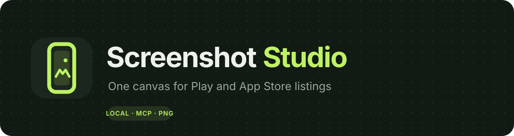

# @tigawanna/screenshot-studio

<p align="center">
  
</p>

Local canvas for **Google Play** and **App Store** listing screenshots. One board can hold several scene strips (five-up phone rows). Clone a strip for Apple or Android, edit each independently, then export every strip as PNGs.

The studio is a TanStack Start app. Boards are SQLite files on disk. An MCP endpoint on the same server lets Cursor (or any MCP client) list boards and mutate scene strips while you watch the canvas.

> [!WARNING]
> **The MCP endpoint is experimental and not production ready.** Tool names and schemas may change, there is no authentication, and CORS is open. Keep it bound to `127.0.0.1` and treat boards as disposable. The editor and PNG export are the stable, supported surface. See [docs/mcp.md](./docs/mcp.md).

> **Usage guide:** [docs/usage.md](./docs/usage.md) covers the editor workflow, board files, export, and live updates. Release notes: [CHANGELOG.md](./CHANGELOG.md).

```bash
pnpm --filter @tigawanna/screenshot-studio dev
# http://127.0.0.1:4320

npx @tigawanna/screenshot-studio
# starts the built server (run pnpm build in this package first)
```

## Using the editor

1. Create a board from the landing list. Size and slice count apply to the **active scene strip**, not the whole project.
2. Drop Play and App Store devices on the same strip if one layout should serve both stores. Use **Phones · both stores** to stack a pair.
3. Right-click a strip title bar for **Duplicate strip** or **Delete strip**. Header **Clone** can also retarget Apple / Android. Home **Clone** still duplicates the whole board file. The last remaining strip cannot be deleted.
4. Drag the strip title bar to move a collection. Ordinary drag still moves devices and text. **Recenter** (or `0`) fits every strip back in the view if you zoom or pan away.
5. Click a numbered slice to give it its own fill. Rename the strip in the header or inspector (`Scenes · Apple` → whatever you want).
6. **Export** zips every scene strip on the board.

## Where files live

Default folder (next to the process working directory):

```
.screenshot-studio/
  projects/
    <board-id>.sqlite
```

Each `.sqlite` holds that board’s scene strips, layers, assets, and event log.

Override the folder:

```bash
SCREENSHOT_STUDIO_DATA=/path/to/studio-data pnpm --filter @tigawanna/screenshot-studio dev
```

Open **Settings** on the board list or inside a board to copy the live paths. Changing the folder requires a restart.

## MCP (agents) — experimental

> **Not production ready.** See the warning at the top of this README and the [MCP guide](./docs/mcp.md) for the full status, tool reference, and limitations.

The studio must be **running**. MCP is Streamable HTTP on the same origin (`http://127.0.0.1:4320/mcp` by default) — it does not open SQLite itself, so it uses the same files as the UI.

### Cursor

1. Start the studio (`pnpm --filter @tigawanna/screenshot-studio dev` or `npx @tigawanna/screenshot-studio`).
2. Open **Settings** in the app and copy the Cursor snippet, or write `.cursor/mcp.json`:

```json
{
  "mcpServers": {
    "screenshot-studio": {
      "url": "http://127.0.0.1:4320/mcp"
    }
  }
}
```

If you changed `--port` / `PORT` / `HOST`, copy the URL from Settings instead of guessing.

3. Reload MCP in Cursor. Ask the agent to list boards or clone a strip for Apple.

The full tool list, JSON-RPC probe commands, and known limitations are in [docs/mcp.md](./docs/mcp.md). `GET /api/live?projectId=<id>` is an SSE stream of changes made from either the UI or MCP.

## CLI

```
screenshot-studio [--port 4320] [--host 127.0.0.1] [--no-open]
```

`PORT`, `HOST`, and `SCREENSHOT_STUDIO_DATA` are read from the environment.
